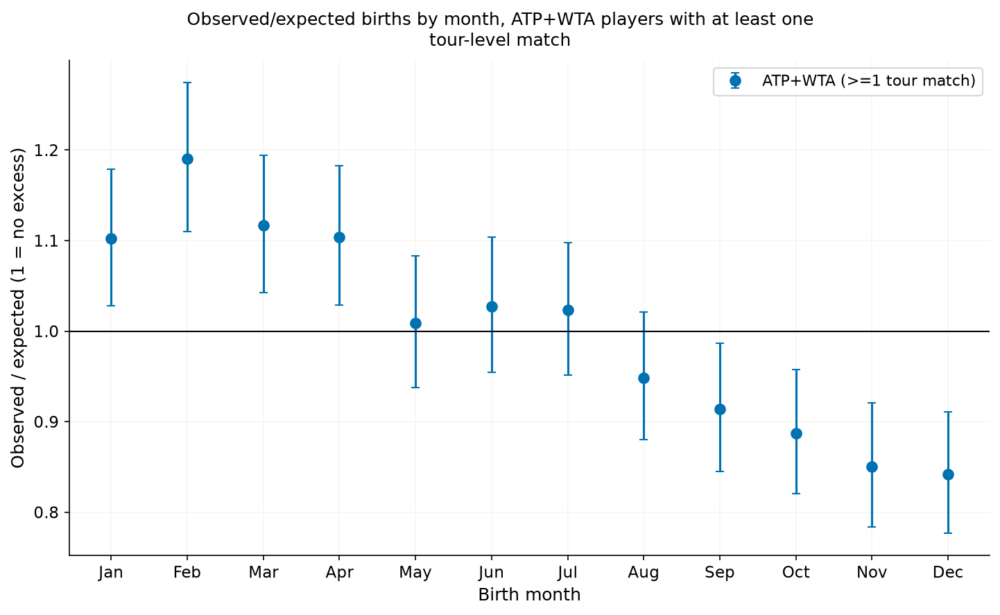
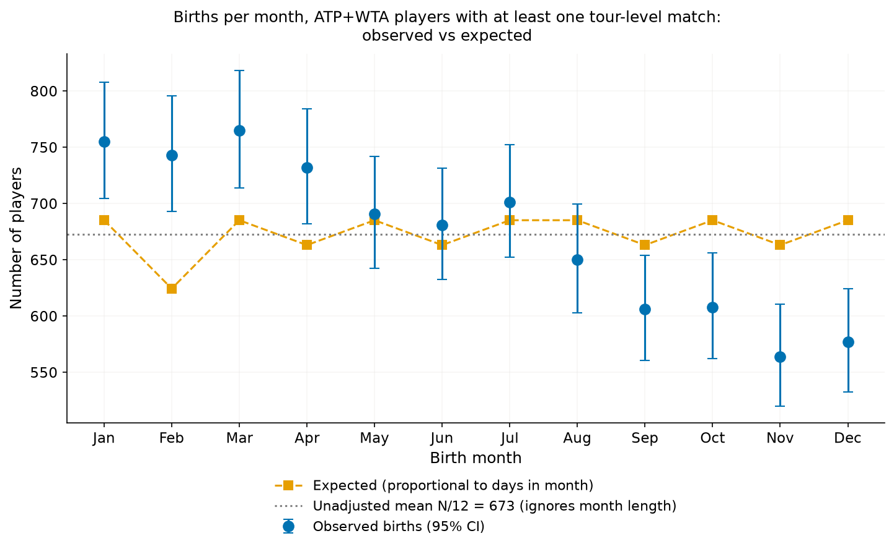
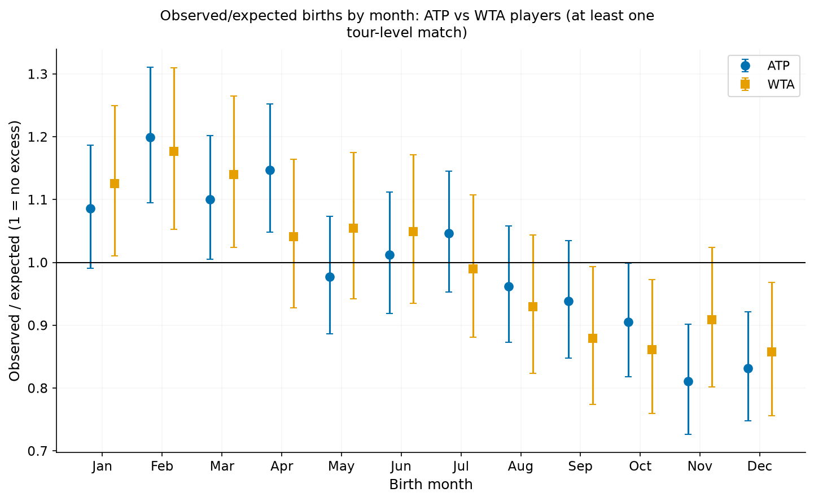
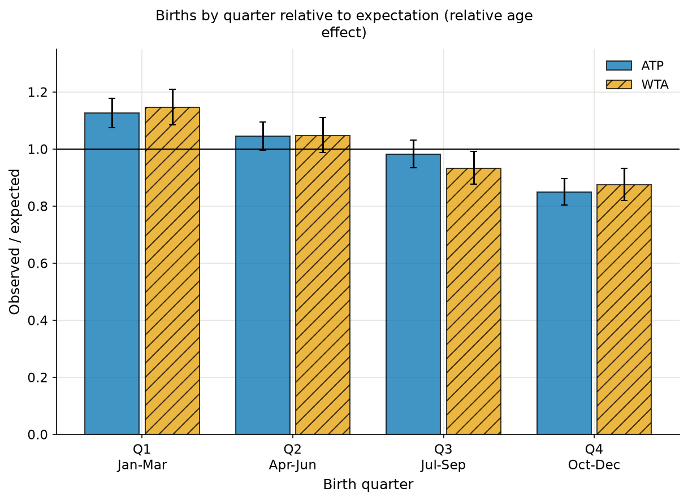
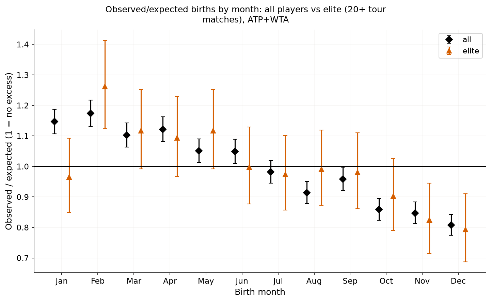

# Methods: are tennis players' birth months unevenly distributed?

This is the technical companion to the [reader summary](README.md). It holds the cleaning steps, tests, robustness checks, full tables and extra figures.

**Question.** Are some birth months over-represented among professional tennis players compared with the average (after accounting for month length)? And is that more than chance?

## Data sources
- **ATP players:** `tml-data/ATP_Database.csv`, TennisMyLife (tennismylife.org), with ATP tour-level matches in `tml-data/YYYY.csv`.
- **WTA players:** `players.csv` (byte-identical to `wta/players.csv`; only one is used) and WTA tour-level matches `matches.csv` (2000-2017) plus `tml-data/YYYY_wta.csv` for 1990-1999 and 2018+ (years never double counted). Jeff Sackmann, `tennis_wta`, licensed **CC BY-NC-SA 4.0**. The TennisMyLife data is used under its own terms; check them before redistributing.

## How to run
From the repository root (see the root README for setup):
```
make birth_months             # or: .venv/bin/python analyses/birth_months/run.py   (regenerates results/ and figures/)
.venv/bin/python -m pytest tests/birth_months      # this analysis's tests (make test runs everything)
```
Layout: `analyses/birth_months/` holds `run.py`, `data.py` (cleaning, placeholder detection, match tallies), `months.py` (month-length expectations, month/quarter tables, trend test), `plots.py`, `results/` (CSV/JSON) and `figures/`; tests are in `tests/birth_months/`. Loaders, Clopper-Pearson/Holm/chi-square helpers and the plot style come from the shared package `src/tennis/`. Output is deterministic (no randomness); data paths come from `tennis.paths`.

## Cleaning (rows in -> rows out)
| step | WTA | ATP |
|---|---:|---:|
| rows in | 20,662 | 12,939 |
| duplicate player ID | 0 | 0 |
| missing birth date | 518 | 3,926 |
| unparseable / invalid date | 0 | 0 |
| impossible year (outside 1900-2015) | 0 | 0 |
| same person under a different ID (normalised name + birthdate) | 1 | 4 |
| placeholder dates (excess births on 1 January) | 89 | 54 |
| **rows out (unique players)** | **20,054** | **8,955** |

Total **29,009 unique players** (20,054 WTA + 8,955 ATP); **8,073 have played at least one tour-level match** (3,297 WTA + 4,776 ATP) and 2,806 have played 20 or more.

- **Placeholder / heaping detection.** Unknown exact dates are often stored as 1 January. For each month, the number of births on day 1 is compared with the mean of days 2-28 (one-sided Poisson test, 5% family-wise level over the 12 months, deliberately liberal because a miss inflates January more than a false alarm costs). **1 January is flagged in both lists** (ATP 54 vs 28 expected, ratio 1.9; WTA 89 vs 66, ratio 1.35) and all 1-Jan births are removed (this also removes genuine ones: conservative). No other month's 1st is flagged (`results/placeholder_detection.csv`).
- **Early-January heaping in the WTA "all" list.** Rounded dates (5th, 10th) can also heap. In the WTA list of *all* players 35.3% of January births fall on days 1-10 (expected 32.3%, one-sided p = 0.002), i.e. about 60 surplus births; among WTA players who have played tour-level matches and among ATP players there is no such heaping (32.5%, p = 0.48; ATP 33.1%, p = 0.30) (`results/january_heaping_test.csv`). **Sensitivity** (`results/sensitivity_placeholders.csv`): keeping all dates, or additionally dropping 1-10 January and adjusting the expected January count, changes the Q1/Q4 ratio by at most 0.05 and the conclusion not at all. For "played" players, Q1/Q4 is 1.31-1.33 (WTA) and 1.33 (ATP) under every variant. The January excess among *all* WTA players is partly reduced (ratio 1.20 with all dates, 1.15 after removing flagged dates), so the "all" population is the one to read with the most caution.
- ~30% of ATP players have no birth date, mostly lower-level players; missingness may not be random.
- **Populations.** "All" = every cleaned player in the database (includes many lower-level players, so heaping is worse there). "Played" (**the main population**) = at least one tour-level match in the match files. "Elite" = 20+ tour-level matches (and, separately, best match-time ranking <= 100).
- **WTA coverage after 2017.** Tour-level WTA players for 2018+ come from `tml-data/YYYY_wta.csv`, whose IDs mostly *are* in `players.csv`, but the share with a birth date falls with time: 94% of players in 2018, 89% in 2020, 81% in 2022, 71% in 2024, 59% in 2026 (`results/wta_id_coverage.csv`; 99-100% for every year 1990-2017). Recent debutants are therefore under-represented, and the WTA "played" count (3,297) is also limited because the WTA tour-level files start in 1990.

## Method
Expected count in month *m* = N x days(m)/365.25 (February = 28.25). Tests: chi-square goodness of fit (df 11) with Cramer's V; per-month ratio observed/expected with exact (Clopper-Pearson) 95% CIs and standardised residuals; per-month exact binomial tests with **Holm correction** across the 12 months; a quarter-level chi-square (df 3); and a Poisson regression (log-days offset) of count on month index, giving the December-vs-January rate ratio. The trend test's standard error is scaled by the Pearson dispersion **only when it exceeds 1** (the estimate from 12 counts can fall below 1 by chance and would otherwise shrink the SE; for "played" the Poisson SE is used). The decade and hemisphere splits and the elite definitions are **exploratory** (no multiplicity control).

## Results (main population: players with at least one tour-level match)
| Population | N | chi-square (df 11) | p | Q1/Q4 ratio | Dec/Jan rate ratio (p) | Months above average (Holm 5%) |
|---|---:|---:|---:|---:|---|---|
| **ATP+WTA, played** | **8,073** | **94** | **2e-15** | **1.32** | **0.72 (1e-20)** | **Jan, Feb, Mar, Apr** (below: Oct, Nov, Dec) |
| WTA, played | 3,297 | 38.5 | 6e-5 | 1.31 | 0.72 (4e-9) | Feb |
| ATP, played | 4,776 | 63 | 3e-9 | 1.33 | 0.72 (9e-12) | Feb, Apr |
| ATP+WTA, elite (20+ matches) | 2,806 | 43.5 | 9e-6 | 1.32 | 0.73 (3e-5) | Feb (below: Nov, Dec) |
| ATP+WTA, all players (placeholders removed) | 29,009 | 414 | 8e-82 | 1.36 | 0.69 (1e-37) | Jan-Jun (below: Aug, Oct-Dec) |

Per-month ratios for ATP+WTA "played" (observed/expected): Jan 1.10, Feb 1.19, Mar 1.12, Apr 1.10, May 1.01, Jun 1.03, Jul 1.02, Aug 0.95, Sep 0.91, Oct 0.89, Nov 0.85, Dec 0.84. Full tables: `results/`.


*Observed/expected births per month with 95% CIs (lead figure).*






**Exploratory splits** (`results/summary_stats.json`, `results/months_*.csv`):
- *Birth decade* (played): the early-year excess appears in every decade (Q1/Q4: WTA 0.94 pre-1970, then 1.26, 1.48, 1.33; ATP 1.11, 1.44, 1.60, 1.40; the oldest groups are small and noisy).
- *Hemisphere* (pooled ATP+WTA, played): **southern hemisphere (n = 1,209) Q1/Q4 = 1.34** (Q1 ratio 1.21, Q4 0.90; chi-square p = 0.003); northern (n = 6,571) 1.31. The ATP-only southern split (n = 808, Q1/Q4 1.17) was too small to say anything. An excess of early-year births in *both* hemispheres is what the relative age effect predicts (the 1 January cut-off is the same everywhere), whereas ordinary seasonal birth patterns, being roughly reversed between hemispheres, would not produce it. The southern-hemisphere country list is approximate (`SOUTH` in `run.py`).

## Interpretation and caveats
- **Relative age effect.** Players born in Jan-Apr are over-represented by 10-19% and those born in Oct-Dec under-represented by 11-16% relative to expectation. This matches the relative age effect: junior tennis groups use calendar-year age cut-offs, so those born early in a cohort are older and bigger when selected. The effect remains among elite players (Q1/Q4 1.32), but the sample is smaller, so fewer individual months are significant.
- **No general-population baseline.** National birth statistics were not used (none are in the repository and no external data were added), so seasonal birth patterns in the general population (which differ by country and era) are not removed; the expected counts assume only that births are uniform across days. Typical national seasonal swings are of the order of 5-10%, much smaller than the observed Q1/Q4 gap of ~30%, and the same early-year excess in the southern hemisphere argues against a seasonality explanation, but a weighted baseline (UN monthly births by nationality and birth year) would be the proper check and is not done here.
- **Multiple testing.** Per-month p-values use Holm correction. The overall chi-square, quarter test and trend test are single tests; the splits are exploratory. Players are not independent of country (national cohorts share cut-off dates), which the chi-square does not model.
- **Selection.** Missing birth dates (mainly ATP), falling birth-date coverage for recent WTA debutants, the "played" cut-offs and residual placeholder dates can shape the populations (see above).
- Statistical significance is not effect size: Cramer's V is ~0.03-0.04, a small effect that is detectable only because of the sample size.

## Conclusion
Yes. Tennis players, women and men, are born disproportionately early in the year (January-April) and under-represented in October-December, a gradual decline across the year (about 30% more births in Jan-Mar than in Oct-Dec among players with a tour match). It is far beyond chance, it survives the handling of placeholder dates, and it is consistent with the relative age effect (it appears in both hemispheres), although the lack of a general-population baseline means seasonal birth patterns could explain part of it.

_Figures use the Okabe-Ito colour-blind-safe palette (WTA orange, ATP blue) with distinct markers/hatching; bars/whiskers are 95% CIs._

## Review record

This analysis was independently cross-reviewed by a second agent, and the fixes were verified.
