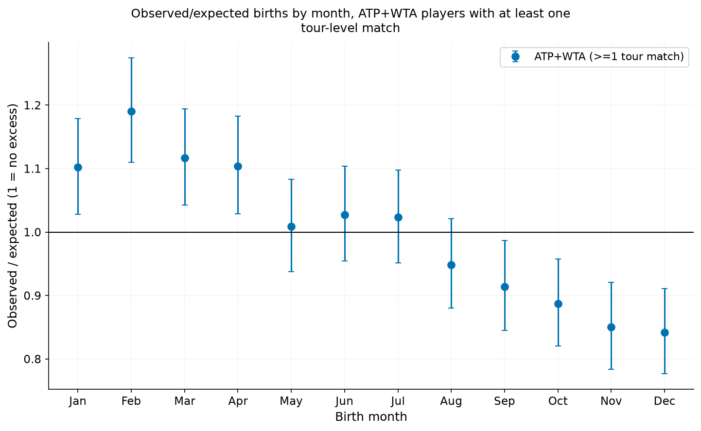
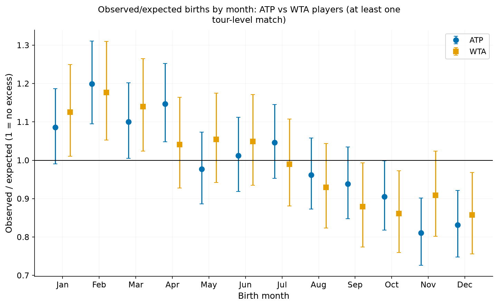

# Are tennis players born earlier in the year than chance would predict?

**Short answer:** Yes. Among the 8,073 players who have played a tour-level match, births in January to April are 10–19% more common than an even spread over the year would give, and births in October to December are 11–16% less common. The pattern is the same for women and men. It matches the relative age effect: junior tennis groups children by birth year, so those born early in the year are older when they are selected.


## Births fall steadily across the year



Each dot compares the births in a month with what an even spread over the year would give (after allowing for month length). A ratio of 1.00 means exactly as expected. February is highest at 1.19, and the ratio falls to 0.84 in December. The pooled data are 8,073 players: 3,297 women and 4,776 men.

## Women and men show the same pattern



Women (WTA) and men (ATP) both have about 31–33% more births in January to March than in October to December. The curves have the same shape. The pattern also holds for the 2,806 players with 20 or more tour-level matches (about 32% more), so it is not just a feature of players who barely played.

## What this does and doesn't show

- **It is a small effect in absolute terms.** The pattern is clear only because the sample is large. A player's birth month tells you very little about any one person.
- **We can't rule out some seasonal birth pattern.** We assumed births are spread evenly over the year and did not use national birth statistics. Ordinary seasonal swings are usually 5–10%, much smaller than the 30% gap seen here. The southern hemisphere shows the same early-year excess (about 34% more), which a simple seasonal explanation would not produce, but it is not a full test.
- **Missing and placeholder birth dates.** Many dates are stored as 1 January when the real date is unknown. We removed all 1 January births, which also removes some real ones, and the result barely changes. About 30% of men in the database have no birth date.
- **Recent women players are under-counted.** The share of women with a known birth date falls for players who started after 2018.
- **The splits by birth decade and hemisphere are exploratory.** They are meant to check consistency, not to give separate firm findings.

## Data

- **Men (ATP):** [TennisMyLife](https://stats.tennismylife.org) player database and ATP tour-level matches. No stated licence; credit given.
- **Women (WTA):** Jeff Sackmann / Tennis Abstract, `tennis_wta` player list and tour-level matches, licensed [CC BY-NC-SA 4.0](http://creativecommons.org/licenses/by-nc-sa/4.0/). WTA matches for 1990–99 and 2018 onwards come from TennisMyLife.

## More detail

- [METHODS.md](METHODS.md) has the cleaning table, tests, robustness checks, full results and extra figures.
- This analysis was independently cross-reviewed by a second agent, and the fixes were verified.

## Reproduce

```bash
make birth_months
```
