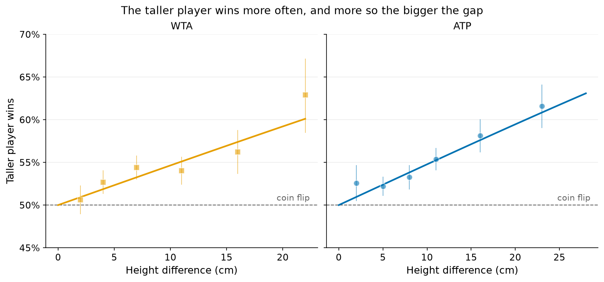
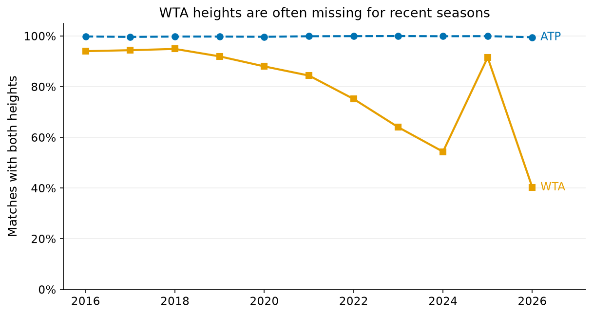

# Can height alone predict who wins?

**Question.** If you knew only the two players' heights, how often could you pick the winner of a tour-level match? And does height still help once you know their rankings?

**Answer in plain words.**

**Height alone picks the winner 54% of the time,** against 50% for a coin flip. Picking the better-ranked player instead gets 63–64% right (2023–26 test period).

| Tour | Height-only model | Taller player wins (when heights differ) | Ranking only |
|---|---|---|---|
| WTA | 53.6% | 53.9% | 63.0% |
| ATP | 54.3% | 54.9% | 64.0% |

The bigger the height gap, the bigger the edge: with a gap of 20 cm or more the taller player wins about 60–63%.

**Once rankings are known, height adds essentially nothing to the picks.**
- Accuracy: 63.0% → 63.0% (WTA) and 64.0% → 63.9% (ATP).
- The *probabilities* get very slightly better. For the ATP that gain is small but clear; for the WTA it is borderline, with the AUC gain's 95% CI reaching zero.

**Surface.** On the ATP, height matters most on grass and not at all on clay once ranking is known. The difference between surfaces is clear (p < 0.001). On the WTA, height's effect is about the same on every surface (p = 0.61).

**The serve link is an association, not a proven mechanism.**
- Taller players served better in the previous season, and that serve record accounts for about half of height's effect given ranking:

| Tour | Share of height's effect accounted for by the previous season's serve record | 95% CI |
|---|---|---|
| WTA | 48% | 31–73% |
| ATP | 69% | 43–97% |

- **Placebo check:** the previous season's *return* record does the opposite. It makes height's effect *larger*, because taller players tend to return worse.
- **Both together:** holding both serve and return records fixed, most of height's effect remains (only 30% and 8% accounted for).
- So taller players' edge goes hand in hand with a better serve, but their weaker return offsets part of it, and these data cannot separate cause from correlation.



*Share of matches won by the taller player, by height difference, 2016–2026 completed tour-level matches. The line is a logistic model on height difference alone, drawn over the range of the data; the thin lines are 95% CIs (typically ±1–4 points).*

## Data

- **Source:** TennisMyLife `tml-data/YYYY.csv` (ATP) and `YYYY_wta.csv` (WTA), 2016–2026 tour-level main draws ([TennisMyLife](https://stats.tennismylife.org), © TennisMyLife; the WTA part follows Sackmann's `tennis_wta`, CC BY-NC-SA 4.0). It provides heights (`winner_ht`, `loser_ht`), pre-tournament ranks and serve statistics.
- **Cleaning** (`results/cleaning.csv`):

| Step | Matches |
|---|---|
| Match rows | 58,908 |
| Team events (Davis Cup, Billie Jean King Cup) removed | −4,447 |
| Retirements, walkovers and unparseable scores removed | −2,108 |
| **Completed matches** | **52,353** |
| With both heights | 46,981 |
| With both heights and both ranks (used for all models) | 46,854 |

- **Height coverage** (report first):
  - **ATP:** 99.8% of matches have both heights.
  - **WTA:** 78.9% overall, and falling: about 94% in 2016–18, 75% in 2022, 54% in 2024 and 40% in 2026, though 92% in 2025 (figure A1).
- **Handling missing heights:**
  - Missing heights are not imputed; the models use complete cases only.
  - Heights outside 150–215 cm are treated as missing; four WTA values were impossible, for example a date entered as a height.
  - The WTA matches *without* heights involve lower-ranked players: the median better-ranked player is No. 49, against No. 26 when heights are known.
  - On those matches, ranking alone predicts better: 65.2% vs 63.0% (`results/missing_heights_check.csv`).
- **Sensitivity on high-coverage WTA data** (`results/wta_high_coverage_sensitivity.csv`): testing only on 2025, when 92% of WTA heights are known, gives the same picture. Height alone scores 53.7%, ranking 61.1%, and ranking + height 62.0%.
- **2026 is a partial season** (data to early November). It is part of the 2023–26 test period.

## How to run

```bash
make height_predicts_winner     # or: .venv/bin/python analyses/height_predicts_winner/run.py   (~1 min)
.venv/bin/python -m pytest tests/height_predicts_winner
```

- The code is in `data.py` (match table, random order, previous-season serve and return rates), `model.py` (logistic fits, metrics, paired bootstrap), `plots.py` and `run.py`.
- Shared helpers come from `tennis.scores`, `tennis.stats` (`auc`, `log_loss`, `wilson_ci`), `tennis.load` and `tennis.plotting`.
- The fixed seed is `SEED = 20261111`, and the output is deterministic.

## Method

1. **One row per match, players in random order.** For each match a seeded coin decides which player is "player 1".
   - The label is "player 1 won", which is 1 in 49.99% of rows.
   - Without this step, the winner/loser columns would leak the answer.
2. **Predictors.** All of them flip sign when the two players are swapped:
   - `ht_diff` = height of player 1 − height of player 2 (cm);
   - `log_rank_ratio` = ln(rank of player 2) − ln(rank of player 1).
3. **Models.** Logistic regressions **without an intercept**: by symmetry, two equal players have a 50% chance each. Fitted on **2016–2022** and tested on **2023–2026**, on the same complete-case rows for every model:
   - (i) coin flip;
   - height only;
   - (ii) ranking only;
   - (iii) ranking + height.
4. **Metrics on the test period:**
   - accuracy, with a prediction of exactly 50% counted as half right;
   - AUC;
   - log-loss, where a coin flip scores ln 2 = 0.693.
5. **Height's added value.** Two checks:
   - a Wald test of the height coefficient on the training data, with standard errors clustered by tournament;
   - a paired bootstrap over test matches (1,000 replicates) of the gain of (iii) over (ii).

   The bootstrap resamples matches, and matches of the same player are correlated, so its CIs are somewhat optimistic.
6. **By surface:**
   - the taller player's win rate, with Wilson CIs;
   - the odds ratio per 10 cm, from height alone and given ranking;
   - a joint Wald test of height × surface given ranking.
7. **Association with the serve.**
   - Each player's ace rate, serve points won and return points won from the **previous calendar year** are added. This needs at least 300 serve and 300 return points, so these are **established players**: 14,453 WTA and 19,742 ATP matches.
   - I report how much the height coefficient shrinks, with a CI from 200 bootstrap replicates that resample tournaments.
   - The return record serves as a placebo.

## Results

### Model comparison (test period 2023–26)

| Tour | Model | Accuracy | AUC | Log-loss | n test |
|---|---|---|---|---|---|
| **WTA** | Coin flip | 50.0% | 0.500 | 0.693 | 6,094 |
| | Height only | 53.6% | 0.553 | 0.689 | |
| | Ranking only | 63.0% | 0.690 | 0.633 | |
| | Ranking + height | 63.0% | 0.692 | 0.632 | |
| **ATP** | Coin flip | 50.0% | 0.500 | 0.693 | 10,391 |
| | Height only | 54.3% | 0.561 | 0.688 | |
| | Ranking only | 64.0% | 0.698 | 0.629 | |
| | Ranking + height | 63.9% | 0.700 | 0.628 | |

**What height adds to ranking** (`results/height_added_value.csv`):

| Tour | Height OR per 10 cm, given ranking | Log-loss gain (95% CI) | AUC gain (95% CI) | Accuracy gain (95% CI) |
|---|---|---|---|---|
| WTA | 1.11 (1.07–1.16) | 0.0012 (0.0001 to 0.0022) | 0.0018 (0.0000 to 0.0035) | −0.0 points (−0.5 to +0.5) |
| ATP | 1.09 (1.05–1.12) | 0.0010 (0.0003 to 0.0017) | 0.0017 (0.0006 to 0.0027) | −0.1 points (−0.4 to +0.2) |

- **WTA:** a borderline gain in probability quality.
- **ATP:** a small but clear gain.
- **Both:** no gain in correct picks.


*Share of 2023–26 matches whose winner each model predicted correctly (models fitted on 2016–22).*

### By surface (all years, `results/by_surface.csv`, `height_by_surface_interaction.csv`)

| Tour | Surface | Taller player wins | OR per 10 cm (height alone) | OR per 10 cm (given ranking) |
|---|---|---|---|---|
| WTA | Hard | 53.7% (52.8–54.6) | 1.22 | 1.13 (1.08–1.18) |
| | Clay | 53.0% (51.6–54.5) | 1.16 | 1.09 (1.01–1.17) |
| | Grass | 53.8% (51.7–55.8) | 1.25 | 1.16 (1.04–1.30) |
| ATP | Hard | 54.9% (54.1–55.8) | 1.24 | 1.12 (1.08–1.16) |
| | Clay | 52.4% (51.3–53.6) | 1.10 | 1.00 (0.95–1.05) |
| | Grass | 56.4% (54.5–58.2) | 1.34 | 1.24 (1.15–1.33) |

Do the surfaces differ (height × surface, given ranking)?
- **WTA:** no, p = 0.61.
- **ATP:** yes, p < 0.001.


*Share of matches won by the taller player, by surface, 2016–2026; thin lines are 95% CIs.*

### Association with the serve (established players, `results/mechanism_serve.csv`)

Odds ratio per 10 cm, given ranking, on the same rows:

| Tour | Ranking + height | + previous-season ace rate | + serve points won | + return points won (placebo) | + serve and return points won |
|---|---|---|---|---|---|
| WTA | 1.14 | 1.06 (60% accounted, CI 38–89%) | 1.07 (48%, CI 31–73%) | **1.17 (−15%, CI −26 to −7%)** | 1.10 (30%) |
| ATP | 1.10 | 1.09 (7%, CI −27 to 42%) | 1.03 (69%, CI 43–97%) | **1.17 (−66%, CI −110 to −40%)** | 1.09 (8%) |

**Reading.**
- A better serve record goes with a smaller height effect, and a better *return* record with a larger one. That is the pattern expected if height helps on serve and hurts slightly on return.
- With both records held fixed, most of the height effect remains.
- Previous-season statistics are noisy proxies, and they also partly measure overall strength. So these numbers describe associations, not a mechanism.

## Caveats

- **Rankings already contain height's effect.** "Height adds little given ranking" does not mean height is unimportant; its effect is already priced into the ranking.
- **WTA heights are missing non-randomly** in recent years, and the WTA test sample leans to higher-ranked players. The 2025-only check (92% coverage) agrees.
- **Heights are self-reported profile values,** often rounded. Measurement error biases the height effect towards zero.
- **Equal heights** (7% of WTA and 11% of ATP test matches) give the height-only model no information; it predicts 50%.
- **Many estimates are reported** (surfaces, mechanism variants). Treat individual p-values of about 0.01–0.05 with care.

## Conclusion

Height alone predicts the winner about 54% of the time, against 50% for a coin flip and 63–64% for simply picking the better-ranked player. The taller player's edge grows with the height gap. On the ATP it is largest on grass and absent on clay once ranking is known. It goes hand in hand with a better serve (and a slightly weaker return). Adding height to ranking does not improve the picks.

## Appendix



*Figure A1. Share of completed matches with both players' heights recorded.*
