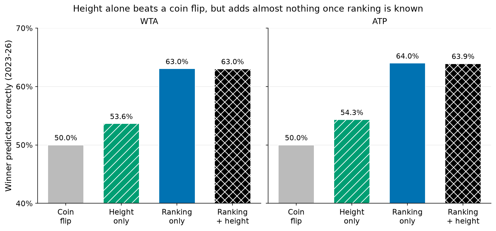
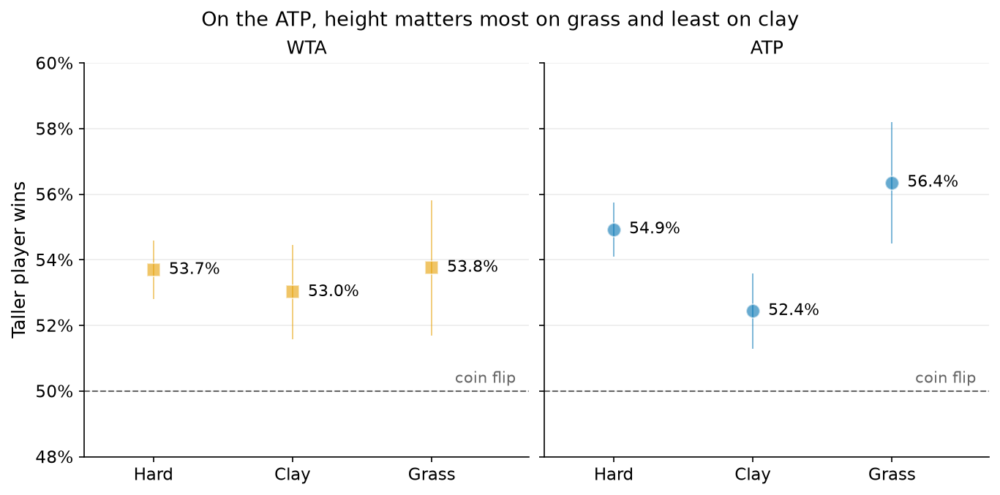
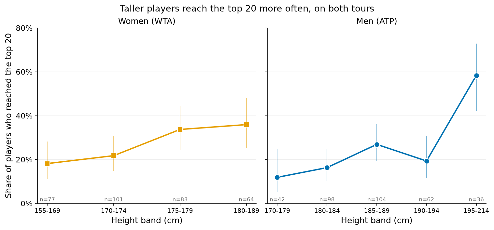

# Can height alone predict who wins a tennis match?

**Short answer:** A little. Knowing only the two players' heights, you would pick the winner 53.6% of the time in women's matches and 54.3% in men's, against 50% for a coin flip. The taller player's edge grows with the height gap.

| Tour | Picking by height alone | Taller player wins (when heights differ) | Picking the better-ranked player |
|---|---|---|---|
| Women (WTA) | 53.6% | 53.9% | 63.0% |
| Men (ATP) | 54.3% | 54.9% | 64.0% |

These are results on matches from 2023–26, with the models built on 2016–22.

## The bigger the height gap, the bigger the edge


With a gap of 20 cm or more, the taller player wins about 60–63% of matches. With a small gap the edge is close to nothing.

## Height adds almost nothing once rankings are known



Accuracy with ranking alone is 63.0% for women and 64.0% for men. Adding height leaves it at 63.0% and 63.9%. The probabilities the model gives get very slightly better. For men the gain is small but clear. For women it is borderline.

## Where height matters most



For men, height matters most on grass and not at all on clay once ranking is known. The surfaces really do differ. For women, height matters about the same on every surface.

## Height also helps players climb the rankings



Height predicts ranking as well as winning, so part of its effect on winning probably runs through ranking. Among 325 women and 342 men with at least 20 ranked tour-level matches since 2016, taller players have better rankings on average (rank correlation 0.22 for women and 0.25 for men, where 1 would be a perfect match). Among women, 18% of those under 170 cm reached the top 20, against 36% of those 180 cm or taller. Among men, 12% of those under 180 cm reached the top 20, against 58% of those 195 cm or taller.

This also explains the result above. Ranking absorbs about 39% of height's effect on winning for women and about 53% for men. That is an association, not a mechanism. Height may help through the serve, through other skills, or through who gets selected and trained.

Two cautions. These are players who already made it to tour level, so the shortest and tallest players who never got there are missing. The link between height and ranking could be stronger among everyone who aspires to play, but these data cannot show that. The men over 200 cm are only about ten players, too few to say whether the effect keeps rising or levels off.

## A link to the serve, not proof

Taller players served better in the previous season. For women that accounts for about half of height's effect (48%), and for men about two-thirds (69%). But taller players also tend to return worse, which cancels part of it out. These data can show that height and a good serve go together. They cannot show that one causes the other.

## What this does and doesn't show

- **Height is already built into rankings.** "Height adds little once we know the ranking" does not mean height is unimportant. Its effect is already reflected in the ranking.
- **Women's heights are often missing.** Heights are known for 78.9% of women's matches overall (99.8% for men), and the share falls to 54% in 2024. Missing ones are more often lower-ranked players. A check using only 2025, when 92% are known, gives the same picture.
- **Heights are self-reported and often rounded.** That makes height look slightly less useful than it is.
- **Many comparisons were made,** so treat individual borderline results with care.

## Data

- **Matches, heights, rankings and serve statistics:** [TennisMyLife](https://stats.tennismylife.org) tour-level main draws, 2016–26 (ATP and WTA). No stated licence; credit given. The women's part follows Sackmann's `tennis_wta` format (CC BY-NC-SA 4.0). 2026 is a partial season.

## More detail

- [METHODS.md](METHODS.md) has the cleaning steps, models, full tables, robustness checks and appendix figure.
- This analysis was independently cross-reviewed by a second agent, and the fixes were verified.

## Reproduce

```bash
make height_predicts_winner
```
