# Methods: have points played and match length changed?

This is the technical companion to the [reader summary](README.md). It holds the data periods, cleaning steps and thresholds, trend models, full results tables, sensitivity checks, caveats and appendix figures.

**Question.** Over the period each source covers (Slam point-by-point data from 2011, tour and Challenger match files from 1995), have (a) the number of points per game, per set and per match, and (b) how long games, sets, matches and points take, changed? Answered separately for women and men where the data allow.

## Sources
- **Grand Slam point-by-point** (`pbp-data/slam/`): Jeff Sackmann, `tennis_slam_pointbypoint` (via the fork [byshiny/tennis_slam_pointbypoint](https://github.com/byshiny/tennis_slam_pointbypoint), commit `6febb77`; the original repository was deleted), **CC BY-NC-SA 4.0** (attribution required, non-commercial). Singles files `YYYY-<slam>-points.csv` only.
- **Tour-level / Challenger match files** (`tml-data/YYYY.csv`, `YYYY_wta.csv`, `YYYY_challenger.csv`): TennisMyLife (tennismylife.org), in Sackmann match format (`minutes`, `w_svpt + l_svpt`). The WTA part derives from Sackmann's `tennis_wta` (CC BY-NC-SA 4.0); check TennisMyLife's own terms before redistributing.

## How to run
From the repository root (see the root README for setup):
```
make match_length_trends      # or: .venv/bin/python analyses/match_length_trends/run.py   (~3 min)
.venv/bin/python -m pytest tests/match_length_trends   # this analysis's tests (make test runs everything)
```
Layout: `analyses/match_length_trends/` holds `run.py`, `pbp.py` (clock/game/set/match tables), `tml.py` (score parsing, tour-level frame, usable periods per group, coverage rules), `trends.py` (yearly summaries and trend regressions, including a model with a level shift), `plots.py`, `results/` and `figures/`; tests are in `tests/match_length_trends/`. Loaders, the bootstrap CI and the plot style come from the shared package `src/tennis/`. Output is deterministic (bootstrap seed fixed; PNGs are saved without a software stamp).

## Data periods and coverage
### Slam point-by-point
| | clock (`ElapsedTime`) | games-won / set-winner columns | used |
|---|---|---|---|
| US Open 2011-2024, Wimbledon 2011-2024 (no 2020) | yes | yes | **core sample** |
| Australian Open, French Open 2011-2017 | yes | yes | supplementary (points per game; by-Slam figure) |
| Australian Open, French Open 2018-2021 | **empty** | **empty** | dropped (369,445 rows) |
| AO/FO 2022+ | no files | | - |

The AO/FO 2018-21 files do have `SetNo`, `GameNo` (numbered cumulatively across the match), `PointServer` and `PointWinner`, so point *counts* could in principle be rebuilt for them (about 2,000 matches); this was not done, because the clock, which is the main subject, is empty and the count outcomes are flat in the data used. **There is no clock data for AO/FO after 2017**; every Slam *timing* trend is therefore based on the US Open and Wimbledon, the same two events in every year (Slam fixed effects, 27 tournament editions). Wimbledon 2016 has men's matches only (126); women's 2016 Wimbledon is absent. The 2011-13 files have fewer matches with point data than later years (about 140-160 men's matches per year at the US Open and Wimbledon against 200-250 from 2014) and fewer first-round matches (30-35% against 42-52%); adding round fixed effects leaves the Slam results unchanged (table below).

### Tour and Challenger match files
Each group is used only from the first year in which its files are usable (`tml.GROUP_START`):

| Group | First year used | Why |
|---|---|---|
| ATP best-of-three | 1995 | Recorded minutes fall from 90-95 (1991-93) to 82-83 (1995-96) with points unchanged, so the earlier years are not comparable |
| ATP best-of-five | 2000 | Almost all matches are Slam matches. Slam minutes in 1993-98 include implausible values (some Slam-year medians of 26-46 minutes), and Slam serve-point counts are about 10% higher in 1992-99 (6.9-7.1 points per game against 6.3 from 2000), so time per point is not comparable earlier |
| Challenger | 2010 | No minutes before 2010. In 2015 only 36% of matches have minutes; a group-year with fewer than half of matches recorded is left out of the minute-based figures (`tml.blank_low_coverage`) |
| WTA | 2009 | Serve statistics are recorded for 89% of matches from 2009 and fewer before. **Minutes exist only from 2016** (1% of matches in 2015, none earlier), so time per point and minutes per match start in 2016 |

Coverage by group and year is in `results/tml_minutes_points_coverage.csv`. 2026 is a part season: it is plotted in the appendix figures but left out of the main figures and of all trend estimates.

## Cleaning and thresholds
Women vs men: the match number's first digit in `match_id` (`...-2101` = women's singles, `...-1101` = men's singles; `WS`/`MS` in the 2021 AO). This was checked against player names in several files. Doubles and mixed are separate files (34 files) and were never read. The second digit of the match number is the round (used for the round-composition check).

`ElapsedTime` is the match clock at the *start* of each recorded point (first point = 0:00:00), so differences between consecutive stamps are **point cycle times** (the point plus the pause before the next one, i.e. including the serve clock).

| step | count |
|---|---:|
| point rows in singles files 2011-2024 | 1,922,136 |
| removed: AO/FO 2018-21 (no clock, no games-won/set-winner columns) | 369,445 |
| removed: `0X`/`0Y` non-point rows | 7,610 |
| **point rows used** | **1,545,081** |
| within-game cycle times: first point of game / missing or malformed clock (e.g. `0`, `1:55:4`, negative) | 243,130 |
| removed: gap <= 0 s (clock didn't tick) | 3,872 |
| removed: gap > 120 s (medical timeout, challenge, delay) | 2,418 |
| **cycle times kept** | **1,295,661** |
| singles matches in used files | 8,486 |
| removed: retired / walkover / unfinished | 317 |
| **complete men's + women's matches** | **8,169** |
| with clean clock duration (no gap > 10 min, no missing stamps) | 7,782 |

Games: 242,954 (3,576 tiebreaks excluded from points-per-game). Sets: 24,539 (24,093 with usable duration).
- **Set winners and match completeness come from the games count** (`P1GamesWon`/`P2GamesWon` at the last point of the set) with a legal-final-score check (6-0..6-4, 7-5, 7-6, 13-12, or an advantage set with a two-game lead); an illegal final score means an unfinished set. The file's `SetWinner` column is *not* used: it is blank at the end of many final-set tiebreaks (Wimbledon 2021-24, US Open 2022) and carries spurious flags in long advantage sets.
- **A tiebreak is a game in which both players served**, ending 7-6 or 13-12 in games, so a regular game that ends an advantage set 7-6 is not mislabelled.
- **Seconds per point** = per-match median of the cleaned within-game cycle times (matches with < 30 valid gaps dropped).
- **Points per game** = per-match mean over regular (non-tiebreak) games.
- **Game duration** = time from a game's first point to the first point of the next game, **only for games after which an even number of games have been played in the set** (so no changeover/set break), non-tiebreak, <= 15 min and with no gap > 10 min; per-match median (>= 5 games).
- **Set duration** = first-to-last point stamp (excludes set breaks and the last point's own length); sets with a gap > 10 min or missing stamps dropped. **Match minutes** = last stamp (excludes the final point); complete, uninterrupted matches only.
- Tour files: completed matches only (no RET/W/O/unparseable/bracketed match-tiebreak scores), Davis/Fed Cup/Olympics/Finals excluded; minutes outside 20-480 or points per game outside 3.9-10 blanked (19 and 53 matches, see `results/cleaning_tml.csv`). 201,354 completed matches in the usable periods. Seconds per point there = 60 x minutes / total points, so it **includes changeovers and set breaks** and is not comparable in level to the clock-based figure.

## Method
Yearly medians with the interquartile range of the unit (match/set) shaded in the appendix figures and 95% bootstrap CI of the median (500 resamples, fixed seed); discrete outcomes (sets, games per set) use means with normal 95% CIs. **Trend test:** OLS of the outcome on year, with controls (Slam fixed effects; sets played; set number; level; for the tour files also sets played and level), **standard errors clustered by tournament-edition**. For the Slam data there are 27 clusters, so the small-cluster correction is used (CR1 variance with a t distribution on G-1 degrees of freedom); CR2 and the wild cluster bootstrap were not run. Reported as change per decade (10 x slope) in natural units; "log" rows give % per decade. A second row excludes 2020. About 240 trend estimates (including the excluding-2020 rows) are reported in `results/trend_tests.csv` without multiplicity correction; the conclusions rest on the coherent pattern across outcomes, not on any single p-value.

**Periods.** The Slam results are reported for 2011-2024 as a whole and for 2011-2015 and 2016-2024 separately, because time per point at the US Open and Wimbledon fell until 2014-15 (much of the fall is the 2013 drop described below) and rose afterwards, so a single straight line over a short window depends on where it starts. For the tour files the whole-period trend is reported together with the periods before 2013 and since 2013 (see the next section).

**The 2013 drop in tour-level match times.** Match times for men's best-of-three, Challenger and Slam matches all fall in 2013, while points per match do not change (`results/tml_2013_step_check.csv`):

| subset | minutes 2011 | 2012 | 2013 | 2014 | points 2012 | 2013 |
|---|---|---|---|---|---|---|
| ATP bo3, Hard | 93.0 | 95.0 | 88.0 | 90.0 | 136.0 | 138.0 |
| ATP bo3, Clay | 98.5 | 99.0 | 91.0 | 92.0 | 136.5 | 135.0 |
| ATP bo3, Grass | 87.5 | 92.0 | 83.0 | 79.0 | 141.0 | 137.5 |
| Challenger, Hard | 88.0 | 92.0 | 83.0 | 86.0 | 135.0 | 131.0 |
| Challenger, Clay | 96.0 | 97.0 | 92.0 | 92.0 | 134.0 | 135.0 |
| Challenger, Grass | 86.0 | 91.0 | 88.0 | 84.0 | 149.5 | 140.5 |

Median seconds per point for men's matches at each Slam, in the tour files (all courts):

| Slam (men's matches in the tour files) | seconds per point 2011 | 2012 | 2013 | 2014 |
|---|---|---|---|---|
| Australian Open | 41.2 | 43.0 | 39.9 | 40.0 |
| French Open | 41.1 | 43.1 | 38.8 | 39.9 |
| US Open | 41.6 | 41.7 | 40.5 | 39.2 |
| Wimbledon | 38.8 | 39.0 | 36.3 | 36.4 |

The point-by-point clock agrees: at the US Open and Wimbledon the median time between points was 31 seconds (2012), 29 (2013) and 28 (2014) for men, and 33, 32 and 31 for women.

**Checked and ruled out: a recording change.** The tour files' minutes were linked, match by match, to the point-by-point clock for 1,757 men's US Open and Wimbledon matches from 2011 to 2019 (links kept only where the two files' serve-point totals agree within 2). The median ratio of tour-file minutes to clock minutes is 0.99 to 1.00 in every year, including 2012 and 2013, so the tour files' minutes are the official clock and the 2013 fall is not an artefact of how they were recorded. (This one-off linkage check was done in the cross-review and is not part of the pipeline.) The drop also happens within tournaments: Men, best of 3: 55 of 57 tournaments played in both seasons have a lower median time per point in 2013 (median change -3.0 s); a model with a tournament effect gives -2.8 s (-3.1 to -2.4). Challenger: 94 of 102 tournaments played in both seasons have a lower median time per point in 2013 (median change -2.1 s); a model with a tournament effect gives -2.2 s (-2.5 to -1.9). It is sharp at the season boundary and flat within each season. Points per match are unchanged, so the drop means that points were played faster.

**Likely explanation.** From the 2013 season the ATP changed its penalty for slow play between points (a repeat offence by the server now costs a first serve) and umpires enforced the 25-second rule much more strictly, as reported at the time ([SI, 2013](https://www.si.com/tennis/2013/03/10/rafael-nadal-new-atp-enforcement-of-time-violation-rule-a-disaster)). The Grand Slams have their own rules but saw a similar fall the same year, so the link is likely but not proven. These data cannot say what exactly changed.

**How the trend is modelled.** Because the drop is real, the net change over a period includes it, and METHODS leads with that. For men's best-of-three over 1995-2025 the net change is +6.2 minutes and +2.3 seconds per decade (rows "whole, no step term" in `results/trend_tests.csv`), made up of +8.0 minutes and +3.2 seconds per decade before 2013 and +13.9 minutes and +5.1 seconds since. As a secondary description, the trend with a one-off level shift from 2013 (`trends.trend_with_step`) gives the rise excluding the 2013 drop: +9.5 minutes and +3.7 seconds per decade. Outcomes that are not time-based (points, games per set, sets) have no shift term.

**Rule changes and events** are drawn as vertical lines in the Slam figures (explained under each figure): the 25-second serve clock (US Open 2018), Wimbledon's 12-12 final-set tiebreak (2019), COVID-19 (2020), and the 10-point tiebreak at 6-6 (2022). Tour-level figures mark only the 2013 enforcement change and 2020. The final-set formats were checked directly in the data (`results/final_set_tiebreak_check.csv`, deciding sets of complete matches; tiebreaks identified as games with two servers):

| | final set, observed in the data |
|---|---|
| US Open 2011-2021 | tiebreak at 6-6; 7-point (a share of the tiebreaks end with fewer than 10 points) |
| US Open 2022-24 | tiebreak at 6-6; 10-point (no tiebreak under 10 points) |
| Wimbledon 2011-2018 | no tiebreak (advantage sets, up to 26-24) |
| Wimbledon 2019, 2021 | tiebreak at 12-12 (one match each year; 2020 not held) |
| Wimbledon 2022-24 | 10-point tiebreak at 6-6 (7, 10 and 11 deciding sets) |
| Australian and French Open 2011-17 | no tiebreak (advantage sets) |

## Results
Sample sizes: 5,493 core Slam matches with usable measures (US Open and Wimbledon, 2011-2024); 201,354 tour/Challenger matches in the usable periods (`results/sample_sizes.json`).

### Grand Slam point-by-point (US Open + Wimbledon, 2011-2024; change per decade, 95% CI)
| outcome | women | men |
|---|---|---|
| seconds per point | -0.2 s (-1.5 to 1.0), n.s. | -0.2 s (-2.2 to 1.7), n.s. |
| points per regular game | -0.00 (-0.06 to 0.05), n.s. | +0.04 (-0.01 to 0.09), n.s. |
| points per set | +0.6 (-0.5 to 1.7), n.s. | -0.2 (-0.9 to 0.5), n.s. |
| points per match (controlled for sets played) | +1.3 (-1.2 to 3.8), n.s. | -1.7 (-4.3 to 1.0), n.s. |
| game duration | +2 s (-6 to 10), n.s. | +1 s (-10 to 12), n.s. |
| set duration | +0.3 min (-0.7 to 1.4), n.s. | -0.1 min (-1.6 to 1.4), n.s. |
| match minutes (controlled for sets played) | +2.2 min (-0.6 to 5.0), n.s. | +2.4 min (-3.2 to 7.9), n.s. |
| sets per match | +0.01 (-0.03 to 0.05), n.s. | +0.12 (0.03 to 0.22) |

For the same number of sets, men's Slam matches have slightly more sets than a decade earlier (+0.12 per decade), which is why minutes and points per match are controlled for sets played.

**The fall and rise around 2014-15** (same models fitted separately on 2011-2015 and on 2016-2024; the earlier period has 10 tournament editions and wide intervals):

| outcome | period | women | men |
|---|---|---|---|
| seconds per point | 2011-2015 | -8.7 s (-11.8 to -5.6) | -16.8 s (-23.8 to -9.7) |
| seconds per point | 2016-2024 | +3.4 s (2.0 to 4.8) | +1.9 s (-1.1 to 5.0) |
| game duration | 2011-2015 | -51 s (-81 to -21) | -97 s (-128 to -67) |
| game duration | 2016-2024 | +22 s (14 to 30) | +12 s (-5 to 29) |
| match minutes | 2011-2015 | -12.5 min (-21.1 to -3.9) | -47.7 min (-62.1 to -33.3) |
| match minutes | 2016-2024 | +7.4 min (3.5 to 11.3) | +8.3 min (1.1 to 15.5) |

Medians: men 32 seconds per point in 2011, 28 in 2014 and 2015, 31 in 2024; women 33 in 2011, 30 in 2015, 33 in 2024.

**Round composition.** Early rounds are better covered in later years (see the data periods section). Adding round fixed effects leaves the results intact (2011-2024):

| outcome | women | men |
|---|---|---|
| seconds per point | -0.1 s (-1.3 to 1.1) | +0.0 s (-1.8 to 1.9) |
| points per regular game | +0.00 (-0.06 to 0.06) | +0.03 (-0.02 to 0.08) |
| game duration | +3 s (-5 to 10) | +3 s (-8 to 13) |
| points per match | +1.6 (-1.0 to 4.3) | -1.6 (-4.4 to 1.2) |
| match minutes | +2.7 min (0.1 to 5.4) | +3.4 min (-1.7 to 8.6) |

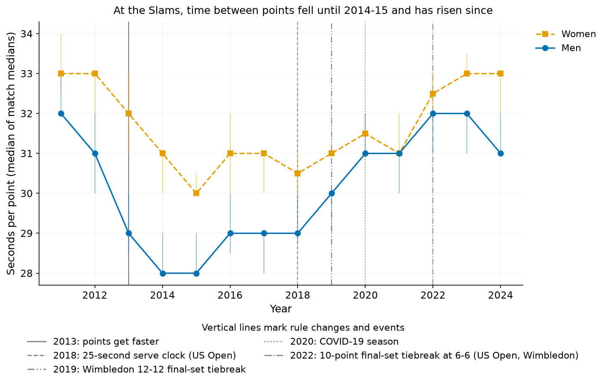
*Median within-game gap between points per match; bars = 95% CI of the median.*

### Tour-level and Challenger files (change per decade, 95% CI; controlled for sets played and level)
| group (first year) | outcome | whole period, net | whole period, excluding the 2013 drop | before 2013 | since 2013 |
|---|---|---|---|---|---|
| WTA (2009 (minutes 2016)) | minutes per match | +10.5 min (9.4 to 11.6) | – | – | +10.5 min (9.4 to 11.6) |
| WTA (2009 (minutes 2016)) | points per match | +1.2 (0.7 to 1.7) | – | +0.6 (-4.5 to 5.7) | +1.0 (0.3 to 1.7) |
| WTA (2009 (minutes 2016)) | seconds per point* | +4.2 s (3.8 to 4.6) | – | – | +4.2 s (3.8 to 4.6) |
| WTA (2009 (minutes 2016)) | points per game | -0.00 (-0.02 to 0.01) | – | -0.04 (-0.18 to 0.10) | +0.00 (-0.02 to 0.02) |
| WTA (2009 (minutes 2016)) | games per set | +0.10 (0.07 to 0.13) | – | +0.03 (-0.26 to 0.33) | +0.08 (0.04 to 0.13) |
| ATP bo3 (1995) | minutes per match | +6.2 min (5.9 to 6.4) | +9.5 min (8.9 to 10.0) | +8.0 min (7.4 to 8.7) | +13.9 min (13.0 to 14.8) |
| ATP bo3 (1995) | points per match | +0.7 (0.5 to 0.9) | – | -0.3 (-0.8 to 0.1) | +1.9 (1.1 to 2.8) |
| ATP bo3 (1995) | seconds per point* | +2.3 s (2.2 to 2.4) | +3.7 s (3.5 to 3.9) | +3.2 s (3.0 to 3.4) | +5.1 s (4.7 to 5.4) |
| ATP bo3 (1995) | points per game | -0.03 (-0.04 to -0.03) | – | -0.05 (-0.06 to -0.04) | +0.01 (-0.01 to 0.03) |
| ATP bo3 (1995) | games per set | +0.10 (0.08 to 0.11) | – | +0.05 (0.02 to 0.08) | +0.12 (0.06 to 0.18) |
| ATP bo5 (2000) | minutes per match | +7.8 min (6.3 to 9.2) | +13.7 min (11.1 to 16.3) | +14.1 min (10.5 to 17.7) | +15.4 min (11.7 to 19.2) |
| ATP bo5 (2000) | points per match | -1.1 (-2.1 to -0.1) | – | -1.9 (-4.0 to 0.2) | -1.9 (-4.2 to 0.4) |
| ATP bo5 (2000) | seconds per point* | +2.2 s (1.8 to 2.7) | +4.2 s (3.4 to 5.0) | +4.1 s (3.0 to 5.2) | +4.4 s (3.3 to 5.6) |
| ATP bo5 (2000) | points per game | -0.03 (-0.05 to -0.01) | – | -0.08 (-0.15 to -0.02) | +0.02 (-0.04 to 0.08) |
| ATP bo5 (2000) | games per set | -0.01 (-0.07 to 0.04) | – | +0.03 (-0.14 to 0.19) | -0.10 (-0.25 to 0.04) |
| Challenger (2010) | minutes per match | +7.6 min (7.0 to 8.2) | +13.0 min (12.3 to 13.8) | +13.7 min (6.0 to 21.4) | +13.0 min (12.3 to 13.8) |
| Challenger (2010) | points per match | +1.6 (1.2 to 2.0) | – | -0.4 (-6.1 to 5.4) | +1.8 (1.3 to 2.4) |
| Challenger (2010) | seconds per point* | +2.7 s (2.5 to 3.0) | +4.9 s (4.6 to 5.2) | +6.0 s (2.8 to 9.2) | +4.9 s (4.6 to 5.2) |
| Challenger (2010) | points per game | +0.04 (0.03 to 0.05) | – | -0.00 (-0.18 to 0.18) | +0.04 (0.02 to 0.06) |
| Challenger (2010) | games per set | +0.06 (0.04 to 0.09) | – | +0.02 (-0.40 to 0.44) | +0.08 (0.05 to 0.12) |

*includes changeover and set-break time. "Whole period, net" is the change over the whole period; "excluding the 2013 drop" adds a one-off level shift from 2013 for the time-based outcomes (men and Challenger); the "before 2013" and "since 2013" columns are separate fits. WTA minutes exist only from 2016, so the WTA minute and time-per-point figures are for 2016-2025; WTA points per match start in 2009.

In log terms (percent per decade, whole period; the shift is allowed for minutes and seconds per point, so these are the rise excluding the 2013 drop for the men's and Challenger groups):

| group | minutes per match | points per match | seconds per point |
|---|---|---|---|
| WTA | +11.0% (9.8 to 12.2) | +1.0% (0.6 to 1.4) | +10.5% (9.4 to 11.6) |
| ATP bo3 | +10.1% (9.5 to 10.7) | +0.5% (0.4 to 0.7) | +9.6% (9.1 to 10.1) |
| ATP bo5 | +9.2% (7.3 to 11.1) | -0.5% (-1.0 to -0.0) | +11.0% (8.8 to 13.1) |
| Challenger | +14.2% (13.3 to 15.1) | +1.4% (1.1 to 1.7) | +12.5% (11.6 to 13.3) |

Men's best-of-three matches: about +10% minutes per decade, of which about +0.5% is more points and about +9.6% is more time per point. Typical medians: ATP best-of-three 83 minutes (1995), 87 (2000), 96 (2012), 89 (2013), 103 (2025); ATP best-of-five 136 (2000), 153 (2012), 136 (2013), 159.5 (2025); WTA 89 (2016), 98 (2025); Challenger 94 (2012), 87 (2013), 101 (2025).

Tour files, Slam matches only (cross-check of the point-by-point clock; whole period, no shift term). Men's best-of-five Slam matches rise by +2.3 seconds per decade net, in line with the net trend for men's best-of-three; the 2013 drop is visible there too:

| group | minutes per match | points per match | seconds per point |
|---|---|---|---|
| WTA (Slams only) | +8.3 min (5.9 to 10.7) | +0.8 (-0.3 to 1.9) | +4.1 s (2.8 to 5.4) |
| ATP bo5 (Slams only) | +8.5 min (7.2 to 9.8) | -0.3 (-1.1 to 0.5) | +2.3 s (1.9 to 2.7) |

Main figures (fig2, fig3, fig4 on the reader page) have the 2013 drop marked as a solid line and 2020 as a dotted line.

### Appendix figures
Slam points per game (A1), sets (A2), points per match by format (A3), seconds per point by Slam (A4), tour-level minutes and points by sets played (A5, A6), tour-level seconds per point by surface (A8), Slam minutes per match by format (A9), Slam game duration (A10) and sets, games and points per game for tour matches (A11).

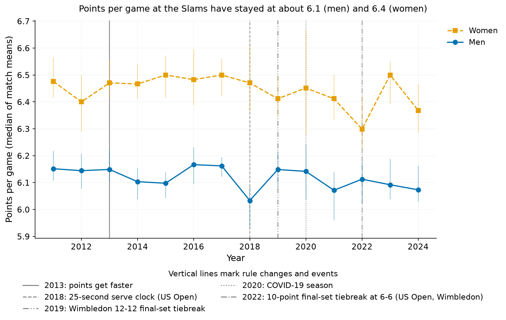
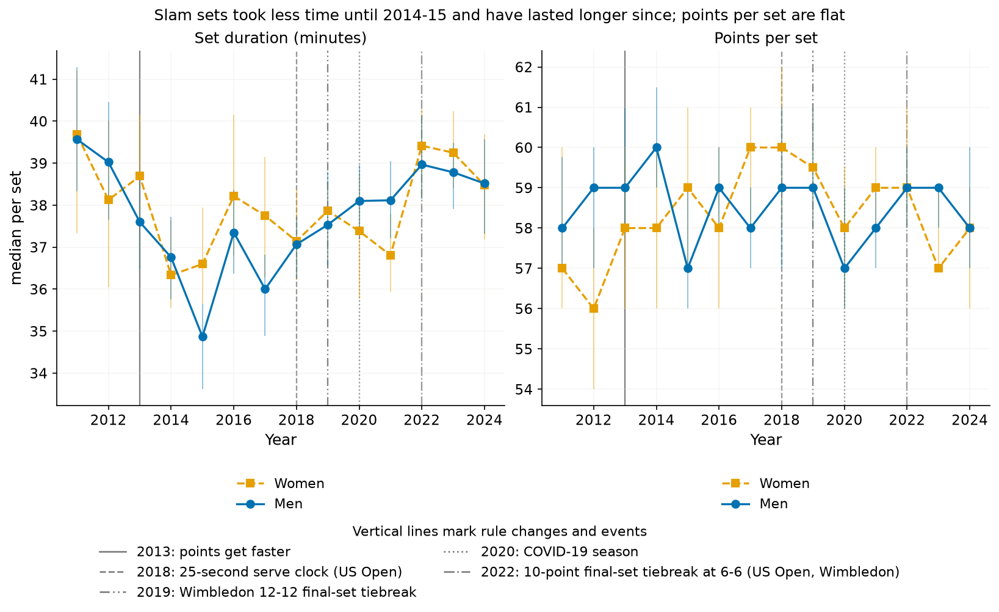
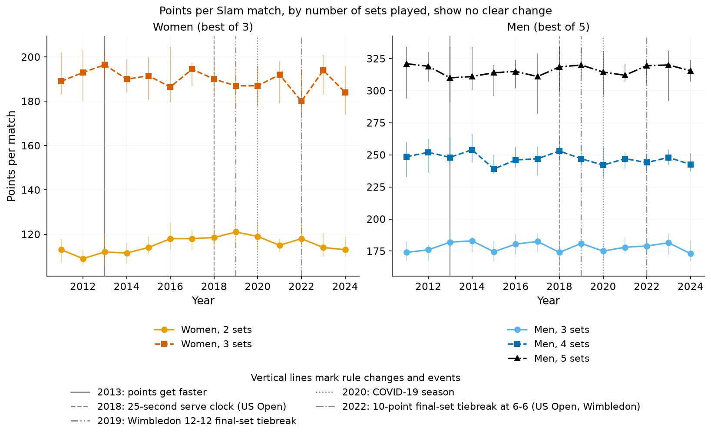
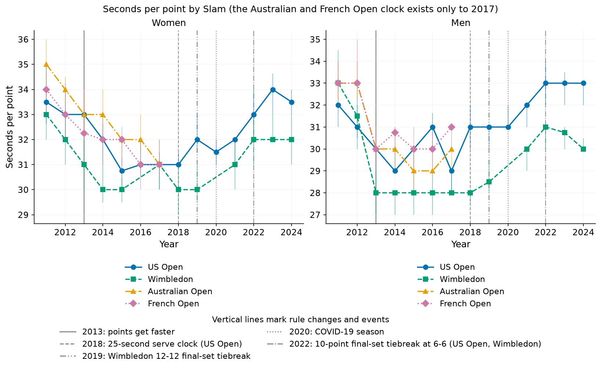
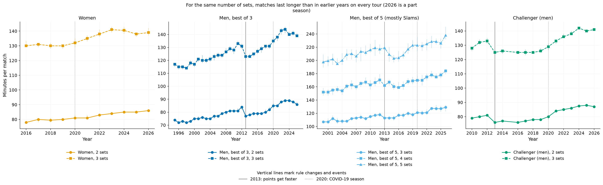
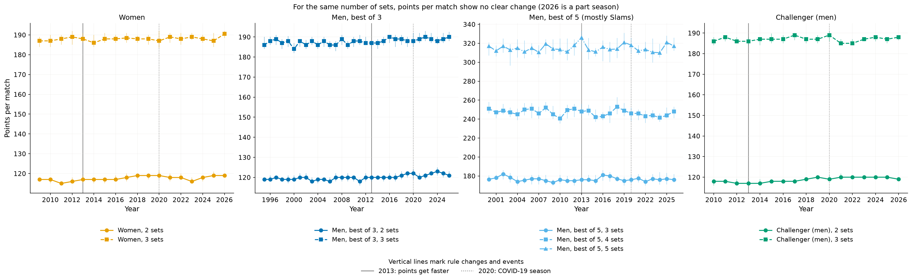
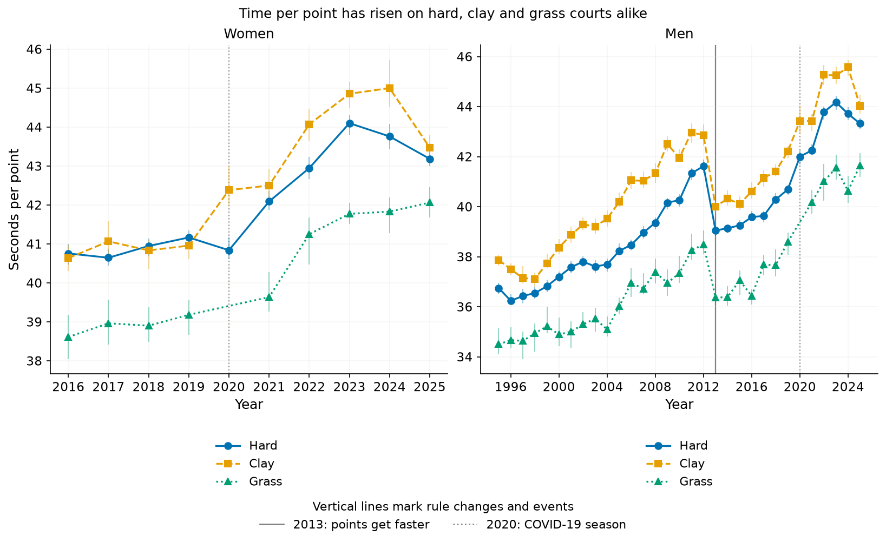
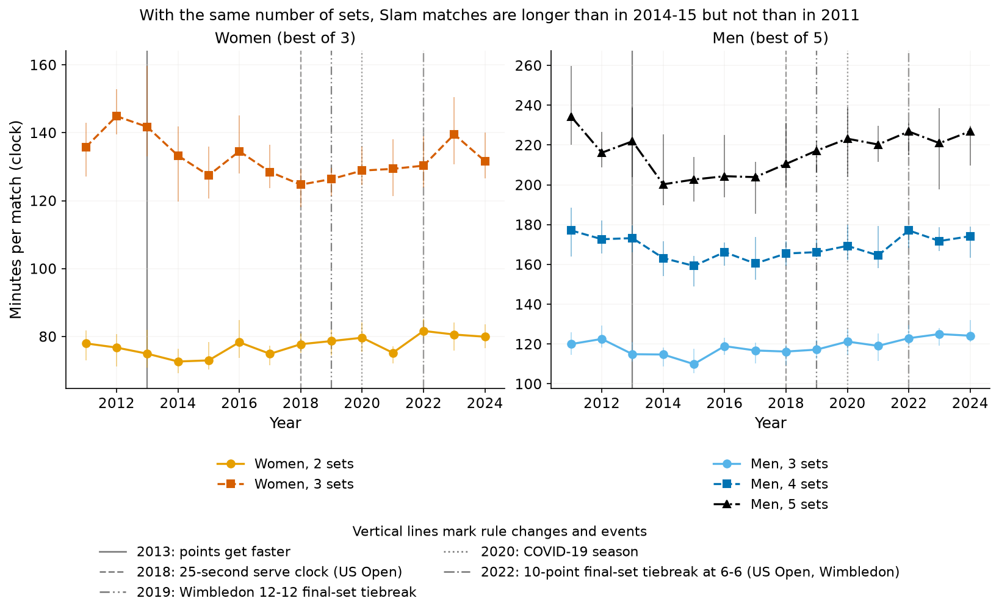
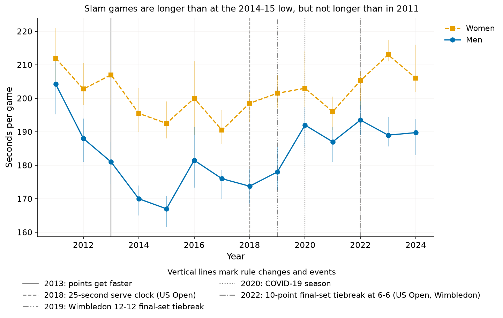
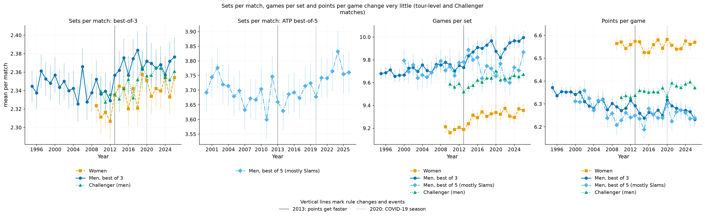

## Interpretation
- **Points played have not changed noticeably**: points per game, per set and per match are flat within noise, for women and men, in the Slams and across about 200,000 tour matches. The small rise since 2013 (1-2 points per decade for men's best-of-three, women's and Challenger matches) is under 2% of a match. Sets per match and games per set are essentially unchanged too. Matches are not longer because more points are played.
- **Time per point has risen.** For men's best-of-three matches, +2.3 seconds per decade net over 1995-2025: +3.2 before 2013 and +5.1 since, with a one-off fall of 2.5 to 3 seconds in 2013 (seconds per point 41.6 in 2012, 39.1 in 2013); for women's tour matches 4.2 since 2016. That is why matches (+8 to +14 minutes per decade for men's best-of-three; +10.5 for women's tour matches) are longer.
- **At the Slams there is no net trend over 2011-24, and the 2011-15 fall is largely the 2013 drop.** Time between points falls to 2014-15 and rises afterwards; the rise is clear for women and for men's match minutes, and uncertain for men's seconds per point.
- **Timing of the rise.** Men's tour-level times rise from the late 1990s. The 25-second clock does not visibly shorten cycle times at the US Open in 2018 (men's median 29 seconds in 2018, no drop); the Slam rise starts around and after it, so this analysis cannot say whether the clock, the post-COVID period or other changes drove it.
- **Tiebreak rules** mostly matter for the very longest matches. Wimbledon's final-set format changed (advantage sets to 2018, then a tiebreak at 12-12, then a 10-point tiebreak at 6-6 from 2022), which mechanically shortens the longest men's matches; the men's match-minute trend is therefore, if anything, conservative, and "controlled for sets played" does not absorb this.

## Caveats
- Timing trends at the Slams rest on the US Open and Wimbledon only (grass + hard), 27 editions: a few editions can move a trend, so intervals are wide even with the small-cluster correction, and 2020 (no Wimbledon, reduced crowds) is a special year (see the excl.-2020 rows in `results/trend_tests.csv`).
- `ElapsedTime` semantics (start of point), the 120 s / 600 s / 900 s thresholds and the odd-games changeover rule are inferences from the data; the clock may be edited or paused differently by Slam and year (e.g. a US Open clock could stop for challenges). Game/set/match durations are slightly truncated (last point excluded).
- The tour files' `minutes` come from tournaments and are the official clock where a point-by-point clock exists (see the 2013 section), but they also include changeovers, set breaks, medical time-outs and delays. About 90-100% of matches in the used periods have minutes, except WTA before 2016 and Challenger in 2015 (left out). `w_svpt + l_svpt` is used as total points.
- Selection: point-by-point data cover mostly Hawk-Eye courts; first rounds are under-represented in 2011-13 (see the round-composition check). Retirements are excluded, which slightly shortens matches.
- Players, surfaces and draw composition change from year to year; only Slam, sets played, round (in the check), surface and tournament level are controlled for.
- ATP best-of-five minutes before 2000 and best-of-three before 1995 are not used. Their problems (inconsistent minutes, higher serve-point counts at the Slams in 1992-99) can't be corrected from the available data.

## Conclusion
Over the periods the data cover, tennis matches have got longer, but not because more points are played: points per game, per set and per match are essentially unchanged. Each point takes longer, by about 3 seconds per decade for men's best-of-three before 2013 and about 5 since, with the same pattern in best-of-five and Challenger matches and about 4 seconds per decade in women's tour matches since 2016. At the Slams, time between points fell to 2014-15 and rose afterwards, so there is no net trend over 2011-24. The 2013 drop in tour-level match times coincides with a change in how the ATP penalised slow play and enforced the 25-second rule; the other causes remain open.

_Figures use the Okabe-Ito colour-blind-safe palette (women orange, men blue) with distinct markers and line styles._
