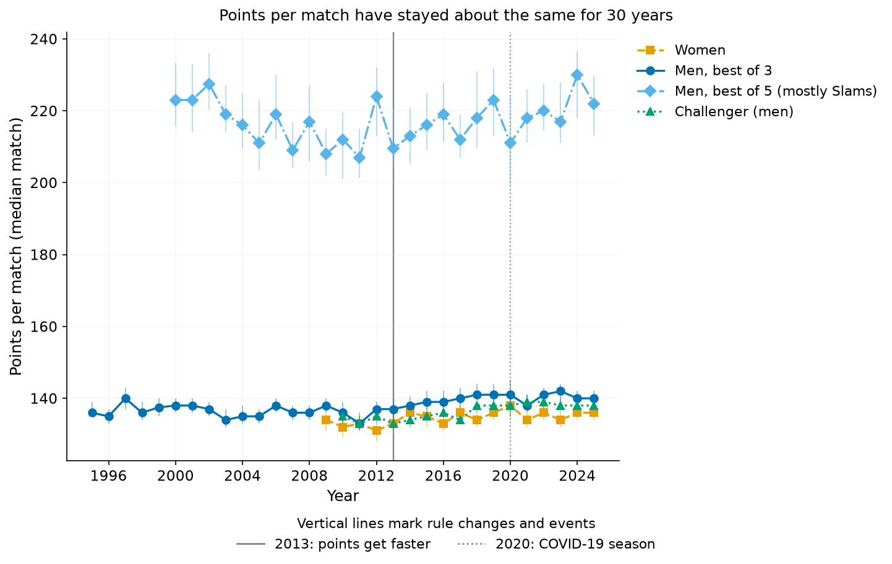
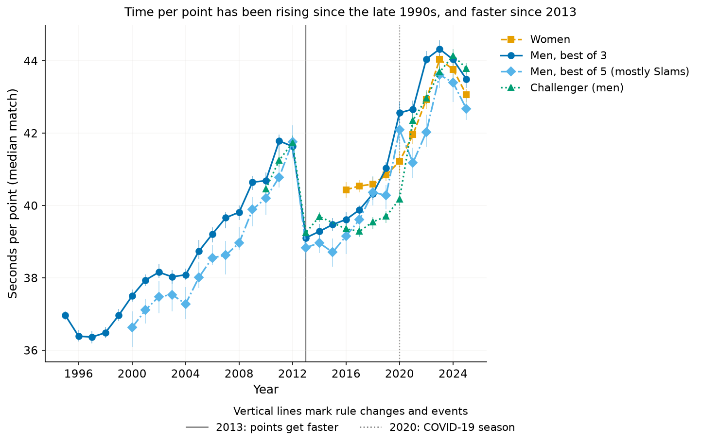
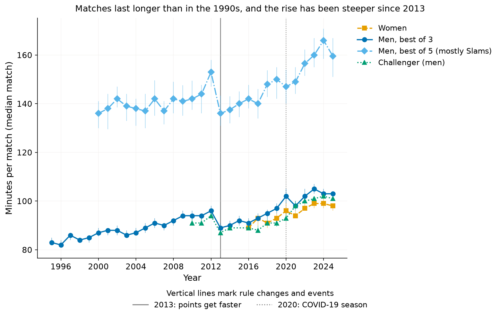
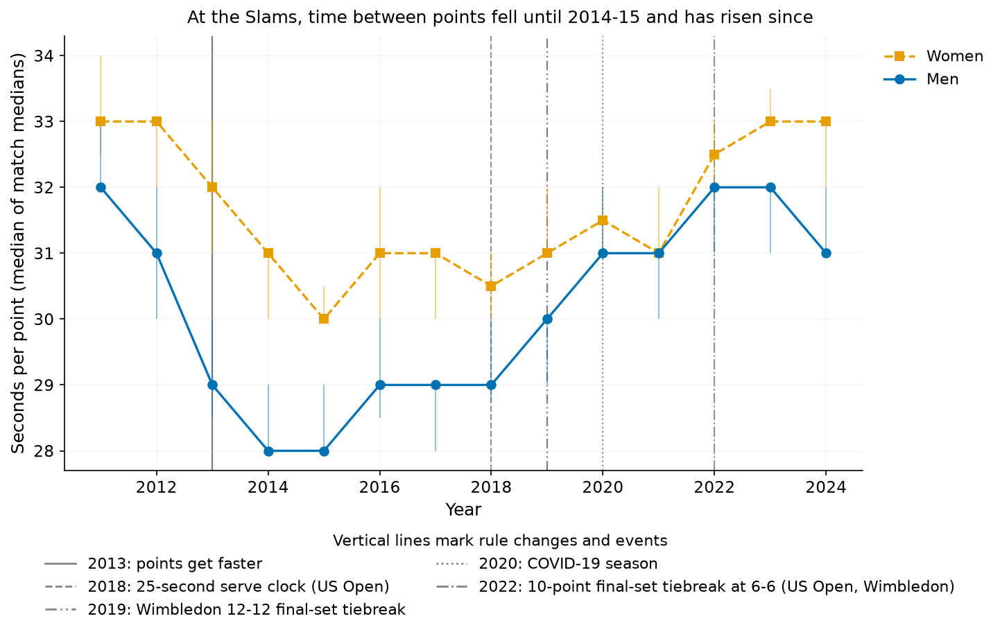

# Are tennis matches getting longer, and why?

**Short answer:** Points per game, set and match have not changed for decades, but each point takes longer. In men's best-of-three tour matches, time per point has risen since the late 1990s, by about 3 seconds per decade at first and about 5 since 2013; a typical match went from 83 minutes in 1995 to 103 in 2025. Women's tour matches, timed only since 2016, went from 89 to 98 minutes. At the Grand Slams, time per point fell until 2014–15 and has risen since, with little net change from 2011.

## Points per match have not changed in 30 years



A men's best-of-three match has had about 137 points since 1995 (140 in 2025), and a women's tour match about 133 since 2009 (136 in 2025). Men's best-of-five matches have about 220 points, and Challenger matches about 135. Within these there is a small rise since 2013, of 1–2 points per decade for men's best-of-three, women's and Challenger matches, less than 2% of a match. Sets per match, games per set and points per game also barely move (see METHODS).

## Each point takes longer

**How time per point is measured.** Only the Grand Slam data measure it directly, because the point-by-point files carry a clock stamp at every point. The tour and Challenger figures are total match minutes divided by points played, so they also include changeovers, set breaks, medical time-outs and delays, and they depend on how each tournament records match time. The Slam figures are therefore the cleaner measure of the pace between points. The tour figures reach back much further but are a rougher measure.



For men's best-of-three matches it rose from 36.4 seconds in 1997 to 41.6 in 2012, fell to 39.1 in 2013, and rose again to 44.3 in 2023. It was 43.5 in 2025. Net over 1995–2025 that is about +2.3 seconds per decade. It is +3.2 per decade before 2013 and +5.1 since. Best-of-five and Challenger matches follow the same pattern. Women's tour matches, which have times only from 2016, rose from 40.4 seconds in 2016 to 43.1 in 2025, about 4.2 seconds per decade.

**The 2013 drop.** In 2013 match times fell by about 7 minutes (2.5 to 3 seconds per point) on the men's tour, the Challenger tour and at all four Slams, while points per match stayed the same. For men's best-of-three matches the median fell from 41.6 to 39.1 seconds per point, and it fell on hard, clay and grass courts alike. The Slams' own point-by-point clock shows the same fall in 2013, so it is not a change in how times were recorded. From the 2013 season the ATP changed its penalty for slow play between points (a repeat offence by the server now costs a first serve) and umpires enforced the 25-second rule much more strictly, as reported at the time ([SI, 2013](https://www.si.com/tennis/2013/03/10/rafael-nadal-new-atp-enforcement-of-time-violation-rule-a-disaster)). The Grand Slams have their own rules but saw a similar fall the same year, so the link is likely but not proven. Because it looks like a one-off change, METHODS shows the trends both with and without it.

## Matches last longer



Because points per match are flat and time per point has risen, matches last longer. Men's best-of-three matches went from 83 minutes in 1995 to 103 in 2025, and men's best-of-five matches from 136 in 2000 to about 160 in 2025. Women's tour matches went from 89 minutes in 2016 to 98 in 2025. For men's best-of-three, the rise is about 8.0 minutes per decade before 2013 and 13.9 minutes per decade since. Women's tour matches gain about 10.5 minutes per decade since 2016.

## The Grand Slams



At the US Open and Wimbledon the clock gives the time between points directly. It fell from 2011 to 2014–15 (men from 32 to 28 seconds, women from 33 to 30), and much of that fall is the sudden drop in 2013 described above. It has risen since, to 31 seconds for men and 33 for women in 2024. Over 2011–24 as a whole there is no net trend: about −0.2 seconds per decade for women and for men, with intervals that include zero (women −1.5 to 1.0, men −2.2 to 1.7). From 2016 to 2024 the rise is clear for women (+3.4 seconds per decade, 2.0 to 4.8) and uncertain for men (+1.9, −1.1 to 5.0). Match minutes at the Slams, for the same number of sets, show the same fall and rise: +2.2 minutes per decade over 2011–24 for women and +2.4 for men, neither clearly different from zero. Points per game stay at about 6.4 for women and 6.1 for men.

## What this does and doesn't show

- **Women's tour times exist only from 2016.** Before that the files have serve points but no match minutes. For the women's tour, points per match go back to 2009 and time per point and minutes only to 2016.
- **Older tour times are not used.** Men's match times before 1995 (best-of-three) and 2000 (best-of-five) look inconsistent, so those years are left out. They were longer than in the late 1990s (about 39–40 seconds per point). We can't check them against an independent clock, so the long-run rise is measured from 1995.
- **The long-run trend depends on how the 2013 drop is counted.** For men's best-of-three matches, minutes rose by about 6.2 per decade between 1995 and 2025 in net terms. Leaving out the one-off 2013 fall, the underlying rise is about 9.5 minutes per decade. Both are shown in METHODS.
- **Slam timing comes from two events.** The Australian and French Opens have a usable clock only to 2017, so Slam timing results use the US Open and Wimbledon, 27 tournament editions.
- **We can't say why points take longer.** At the Slams the rise begins after 2015. The 25-second serve clock introduced at the US Open in 2018 shows no visible drop, and the tour-wide rise began before it. COVID-19, the final-set tiebreak rules (Wimbledon 2019, both Slams from 2022) and other changes cannot be separated here.
- **Retirements are excluded,** which slightly shortens matches. Point-by-point data cover mostly the main show courts.

## Data

- **Grand Slam point-by-point, 2011–24:** Jeff Sackmann / Tennis Abstract, `tennis_slam_pointbypoint`, via the fork [byshiny/tennis_slam_pointbypoint](https://github.com/byshiny/tennis_slam_pointbypoint) at commit `6febb77`. Licence: [CC BY-NC-SA 4.0](http://creativecommons.org/licenses/by-nc-sa/4.0/).
- **Tour and Challenger match files, 1995–2025:** [TennisMyLife](https://stats.tennismylife.org) (no stated licence; credit given), in Sackmann's match format. The women's part derives from Sackmann's `tennis_wta` (CC BY-NC-SA 4.0).

## More detail

- [METHODS.md](METHODS.md) has the cleaning thresholds, trend models, full tables, robustness checks and appendix figures.
- This analysis was independently cross-reviewed by a second agent, and the fixes were verified.

## Reproduce

```bash
make match_length_trends
```
