# Have points played and game duration changed over the last decade?

**Question.** Roughly 2014 to 2024/25, have (a) the number of points per game, per set and per match, and (b) how long games, sets and points take, changed? Answered separately for men and women where the data allow.

## Sources
- **Grand Slam point-by-point** (`pbp-data/slam/`): Jeff Sackmann, `tennis_slam_pointbypoint` (via the fork [byshiny/tennis_slam_pointbypoint](https://github.com/byshiny/tennis_slam_pointbypoint), commit `6febb77`; the original repository was deleted), **CC BY-NC-SA 4.0** (attribution required, non-commercial). Singles files `YYYY-<slam>-points.csv` only.
- **Tour-level / Challenger match files** (`tml-data/YYYY.csv`, `YYYY_wta.csv`, `YYYY_challenger.csv`): TennisMyLife (tennismylife.org), in Sackmann match format (`minutes`, `w_svpt + l_svpt`). The WTA part derives from Sackmann's `tennis_wta` (CC BY-NC-SA 4.0); check TennisMyLife's own terms before redistributing.

## How to run
From the repository root (see the root README for setup):
```
make match_length_trends      # or: .venv/bin/python analyses/match_length_trends/run.py   (~2 min)
.venv/bin/python -m pytest tests/match_length_trends   # this analysis's tests (make test runs everything)
```
Layout: `analyses/match_length_trends/` holds `run.py`, `pbp.py` (clock/game/set/match tables), `tml.py` (score parsing, tour-level frame), `trends.py` (yearly summaries + trend regressions), `plots.py`, `results/` and `figures/`; tests are in `tests/match_length_trends/`. Loaders, the bootstrap CI and the plot style come from the shared package `src/tennis/`. Output is deterministic (bootstrap seed fixed; PNGs are saved without a software stamp).

## Data coverage - important
| | clock (`ElapsedTime`) | games-won / set-winner columns | used |
|---|---|---|---|
| US Open 2014-2024, Wimbledon 2014-2024 (no 2020) | yes | yes | **core sample** |
| Australian Open, French Open 2014-2017 | yes | yes | supplementary (points per game; by-Slam figure) |
| Australian Open, French Open 2018-2021 | **empty** | **empty** | dropped (369,445 rows) |
| AO/FO 2022+ | no files | | - |

The AO/FO 2018-21 files do have `SetNo`, `GameNo` (numbered cumulatively across the match), `PointServer` and `PointWinner`, so point *counts* could in principle be rebuilt for them (about 2,000 matches); I did not, because the clock - the main subject here - is empty and the count outcomes are already flat in the data used. **There is no clock data for AO/FO after 2017**; every Slam *timing* trend is therefore based on the US Open + Wimbledon, the same two events in every year (Slam fixed effects). Wimbledon 2016 has men's matches only (126); women's 2016 Wimbledon is absent.

## Cleaning and thresholds
Men vs women: the match number's first digit in `match_id` (`...-1101` = men's singles, `...-2101` = women's singles; `MS`/`WS` in the 2021 AO). I checked this against player names in several files. Doubles and mixed are separate files (34 files) and were never read. The second digit of the match number is the round (used for the round-composition check).

`ElapsedTime` is the match clock at the *start* of each recorded point (first point = 0:00:00), so differences between consecutive stamps are **point cycle times** (the point plus the pause before the next one, i.e. including the serve clock).

| step | count |
|---|---:|
| point rows in singles files 2014-2024 | 1,569,536 |
| removed: AO/FO 2018-21 (no clock, no games-won/set-winner columns) | 369,445 |
| removed: `0X`/`0Y` non-point rows | 7,081 |
| **point rows used** | **1,193,010** |
| within-game cycle times: first point of game / missing or malformed clock (e.g. `0`, `1:55:4`, negative) | 187,809 |
| removed: gap <= 0 s (clock didn't tick) | 3,073 |
| removed: gap > 120 s (medical timeout, challenge, delay) | 1,870 |
| **cycle times kept** | **1,000,258** |
| singles matches in used files | 6,507 |
| removed: retired / walkover / unfinished | 242 |
| **complete men's + women's matches** | **6,265** |
| with clean clock duration (no gap > 10 min, no missing stamps) | 5,890 |

Games: 187,692 (2,804 tiebreaks excluded from points-per-game). Sets: 18,897 (18,463 with usable duration).
- **Set winners and match completeness come from the games count** (`P1GamesWon`/`P2GamesWon` at the last point of the set) with a legal-final-score check (6-0..6-4, 7-5, 7-6, 13-12, or an advantage set with a two-game lead); an illegal final score means an unfinished set. The file's `SetWinner` column is *not* used: it is blank at the end of many final-set tiebreaks (Wimbledon 2021-24, US Open 2022) and carries spurious flags in long advantage sets. An earlier version used it and wrongly dropped some of the longest completed matches; this is fixed (retirements/unfinished fell from 250 to 242).
- **A tiebreak is a game in which both players served**, ending 7-6 or 13-12 in games, so a regular game that ends an advantage set 7-6 is not mislabelled.
- **Seconds per point** = per-match median of the cleaned within-game cycle times (matches with < 30 valid gaps dropped).
- **Points per game** = per-match mean over regular (non-tiebreak) games.
- **Game duration** = time from a game's first point to the first point of the next game, **only for games after which an even number of games have been played in the set** (so no changeover/set break), non-tiebreak, <= 15 min and with no gap > 10 min; per-match median (>= 5 games).
- **Set duration** = first-to-last point stamp (excludes set breaks and the last point's own length); sets with a gap > 10 min or missing stamps dropped. **Match minutes** = last stamp (excludes the final point); complete, uninterrupted matches only.
- Tour files: completed matches only (no RET/W/O/unparseable/bracketed match-tiebreak scores), Davis/Fed Cup/Olympics/Finals excluded; minutes outside 20-480 or points per game outside 3.9-10 blanked (16 and 23 matches, see `cleaning_tml.csv`). 122,062 completed matches. Seconds per point there = 60 x minutes / total points, so it **includes changeovers and set breaks** and is not comparable in level to the clock-based figure. WTA minutes are mostly absent for 2014-15. 2026 is a part season: plotted, not used in regressions.

## Method
Yearly medians with the interquartile range of the unit (match/set) shaded and 95% bootstrap CI of the median (500 resamples, fixed seed); discrete outcomes (sets, games per set) use means with normal 95% CIs. **Trend test:** OLS of the outcome on year, with controls (Slam fixed effects; sets played; set number; level), **standard errors clustered by tournament-edition**. For the Slam data there are only about 20 clusters, so I use the small-cluster correction (CR1 variance with a t distribution on G-1 degrees of freedom); CR2 and the wild cluster bootstrap were not run. Reported as change per decade (10 x slope) in natural units; "log" rows give % per decade. A second row excludes 2020. About 80 outcome-by-group tests are reported in `results/trend_tests.csv` without multiplicity correction; the conclusions rest on the coherent pattern across outcomes, not on any single p-value.

**Rule changes and events** are drawn as vertical lines (explained under each figure): the 25-second serve clock (US Open 2018), Wimbledon's 12-12 final-set tiebreak (2019), COVID-19 (2020), and the 10-point tiebreak at 6-6 (2022). I checked the final-set formats directly in the data (`results/final_set_tiebreak_check.csv`, deciding sets of complete matches; tiebreaks identified as games with two servers):

| | final set, observed in the data |
|---|---|
| US Open 2014-2021 | tiebreak at 6-6; 7-point (a share of the tiebreaks end with fewer than 10 points) |
| US Open 2022-24 | tiebreak at 6-6; 10-point (no tiebreak under 10 points) |
| Wimbledon 2014-2018 | no tiebreak (advantage sets, up to 26-24) |
| Wimbledon 2019, 2021 | tiebreak at 12-12 (one match each year; 2020 not held) |
| Wimbledon 2022-24 | 10-point tiebreak at 6-6 (7, 10 and 11 deciding sets) |
| Australian and French Open 2014-17 | no tiebreak (advantage sets) |

## Results
Sample sizes: 4,625 core Slam matches with usable measures (men 2,337 / women 2,288 with seconds per point); ~122k tour/Challenger matches.

### Grand Slam point-by-point (US Open + Wimbledon, 2014-2024; change per decade, 95% CI)
| outcome | men | women |
|---|---|---|
| **seconds per point** | **+2.3 s** (0.9 to 3.7) | **+1.8 s** (0.4 to 3.1) |
| points per regular game | +0.04 (-0.04 to 0.13), n.s. | -0.01 (-0.06 to 0.03), n.s. |
| points per set | -0.5 (-1.6 to 0.5), n.s. | -0.3 (-1.6 to 1.0), n.s. |
| points per match (controlled for sets played) | -2.7 (-6.7 to 1.3), n.s. | -0.5 (-3.5 to 2.5), n.s. |
| **game duration** | **+16 s** (7 to 26) | **+14 s** (5 to 23) |
| **set duration** | **+2.0 min** (0.7 to 3.3) | **+1.6 min** (0.4 to 2.9) |
| **match minutes** (controlled for sets played) | **+10.8 min** (6.2 to 15.4) | **+5.6 min** (2.5 to 8.8) |
| sets per match | +0.11 (-0.01 to 0.23), n.s. | -0.03 (-0.08 to 0.02), n.s. |

Medians, 2014 -> 2024: men 28 -> 31 s per point, women 31 -> 33 s; men's game 170 -> 190 s, women's 196 -> 206 s. Excluding 2020 changes nothing material (men +2.3 s, women +1.8 s per decade per point).

**Round composition.** Early rounds are better covered in later years (about 90-100 first-round men's matches per year with point data in 2014-18, 127-128 from 2019). Adding round fixed effects leaves the results intact: seconds per point +2.5 s (1.1 to 3.9) for men and +1.8 s (0.5 to 3.1) for women; match minutes +11.3 and +5.8 min (`results/trend_tests.csv`, rows "+ round fixed effects").


*Median within-game gap between points per match; shaded = interquartile range of matches, bars = 95% CI of the median.*
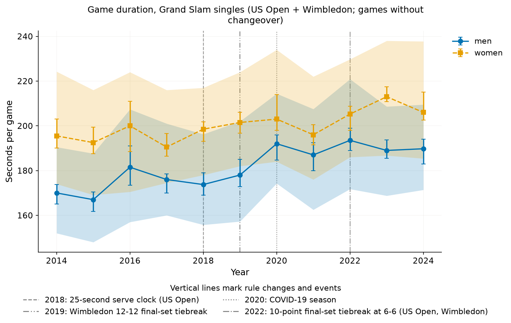
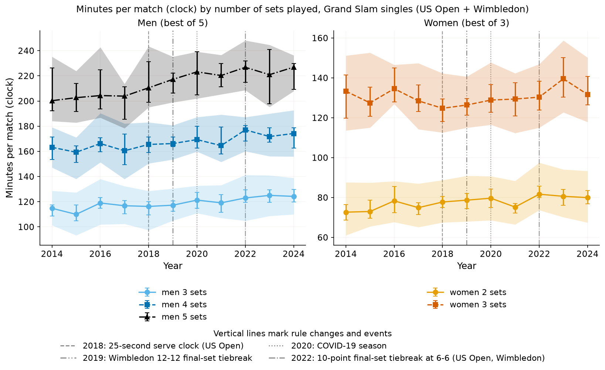

### Tour-level and Challenger cross-check (2014-2025; change per decade, controlled for sets played and level)
| group | minutes per match | points per match | seconds per point* | points per game | games per set |
|---|---|---|---|---|---|
| ATP best-of-3 | **+14.4 min** | +1.6 | **+5.3 s** | +0.02 (n.s.) | +0.08 |
| ATP best-of-5 | **+16.8 min** | -1.8 (n.s.) | **+4.7 s** | +0.03 (n.s.) | -0.13 (n.s.) |
| WTA | **+10.5 min** | +0.7 (n.s.) | **+4.2 s** | +0.01 (n.s.) | +0.05 |
| Challenger | **+14.0 min** | +1.5 | **+5.4 s** | +0.04 | +0.07 |

*includes changeover and set-break time. In log terms, ATP bo3 minutes rise ~15% per decade, of which ~1% is more points and ~14% is more time per point. Typical medians: ATP bo3 90 -> 103 min (2014 -> 2025), WTA 89 -> 98 (2016 -> 2025), Challenger 89 -> 101. Slam-only subsets agree with the pbp analysis in sign and rough size (ATP bo5 Slams +16.8 min, WTA Slams +8.2 min, points per match flat).

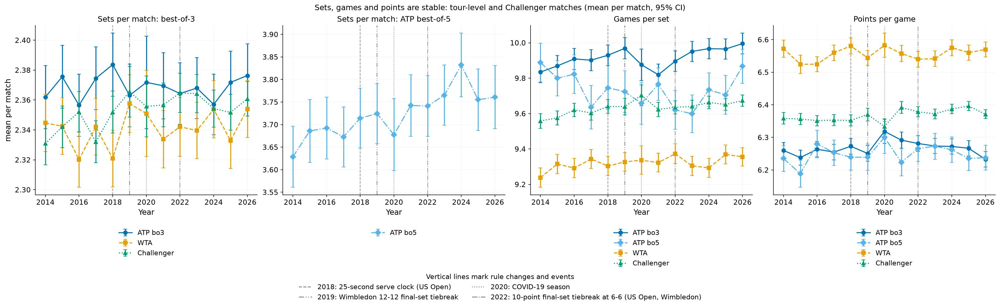

### Appendix figures
Points per game (A1), sets (A2), points per match by format (A3), seconds per point by Slam (A4), tour-level minutes and points by sets played (A5, A6), tour-level seconds per point (A7) and by surface (A8).

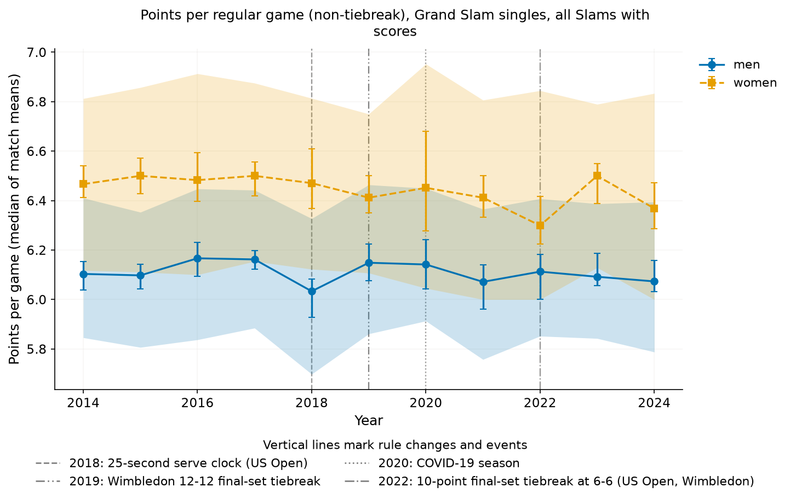
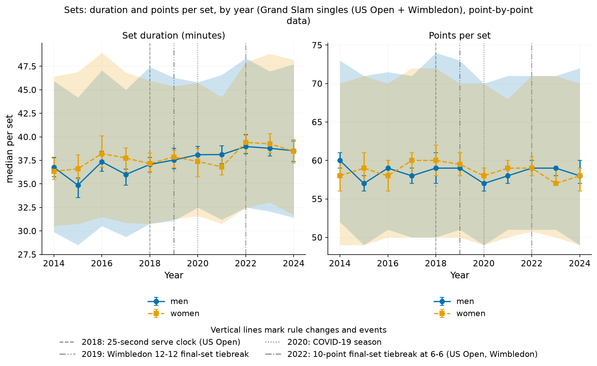
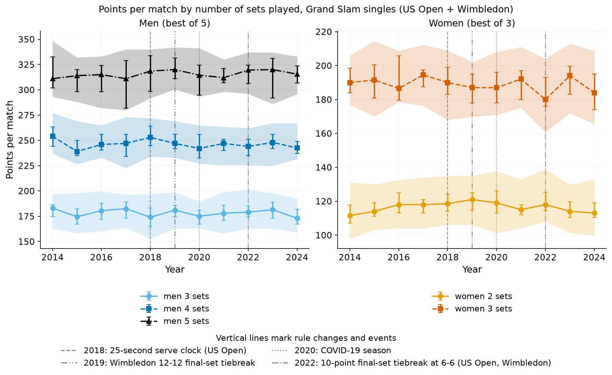
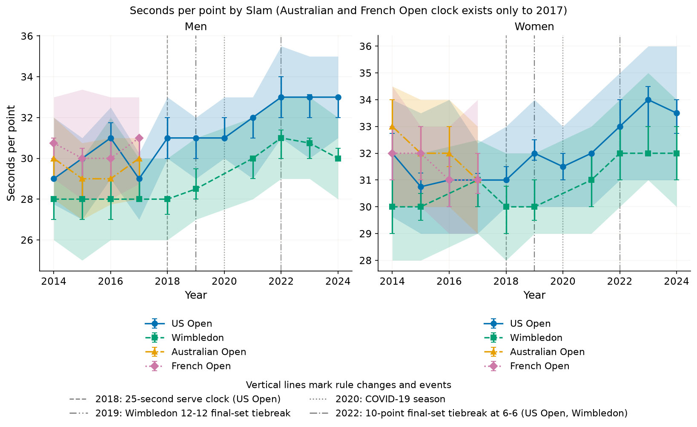
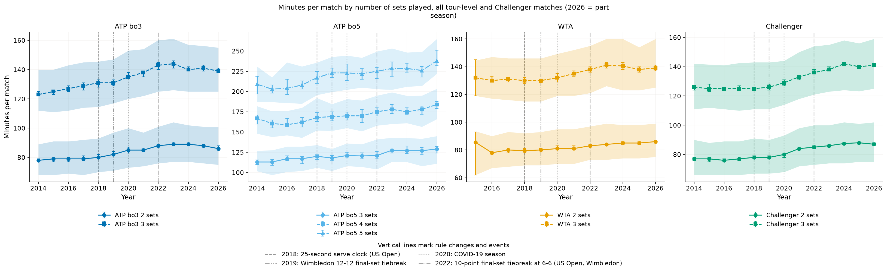
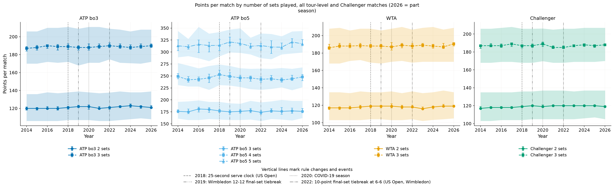
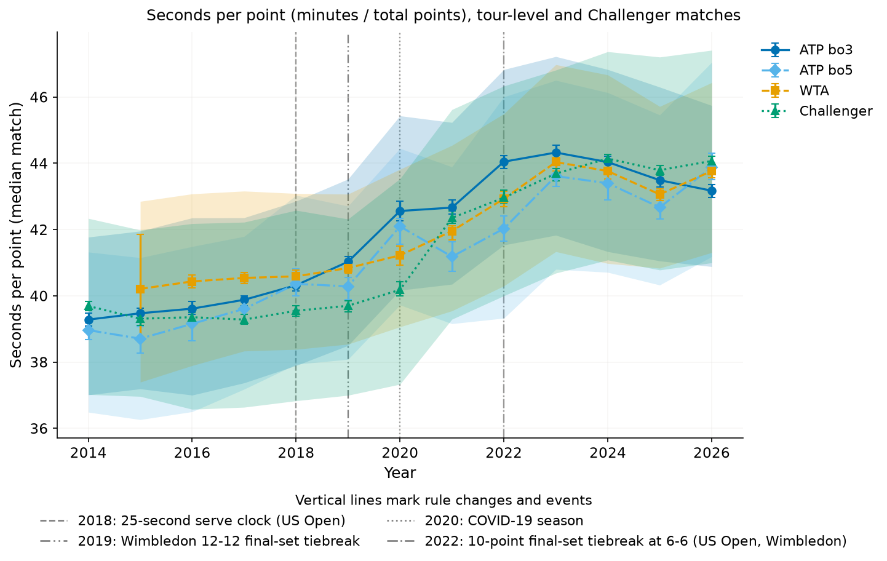
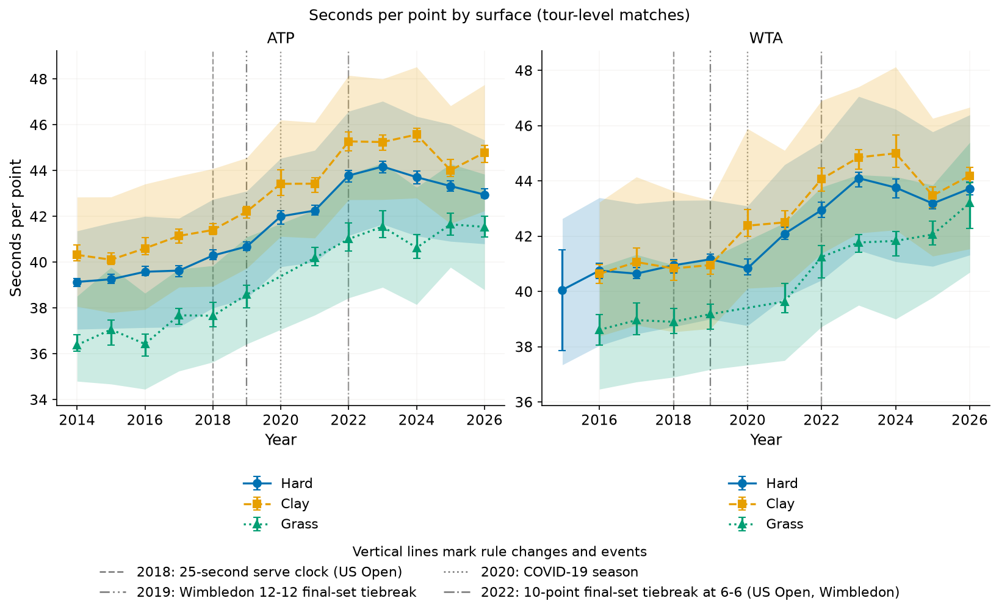

## Interpretation
- **Points played have not changed noticeably**: points per game, per set and per match are flat within noise, for men and women, in the Slams and across ~120k tour matches. Sets per match, and games per set, are essentially unchanged too. Matches are not longer because more points are played.
- **Time per point has risen.** Slam point cycle times are ~2 s per point per decade longer (about 28 to 31 s for men), and the tour-wide figure (including changeovers) rises ~4-5 s per decade. That is why games (+14-16 s), sets (+1.6-2.0 min) and matches (+5.6 to +17 min) are longer.
- **Timing of the rise.** Men's Slam cycle times are roughly flat 2014-2018 (28-29 s), then rise steadily to 32 s in 2022 and plateau (31 s in 2024); women's rise mostly 2021-2023. In the tour files, minutes per match are flat to about 2017 and rise from 2018-19 onwards, most clearly across 2020-2023. The 25-second clock does not visibly shorten cycle times at the US Open 2018 (men's median 29 s in 2018, no drop); the rise starts around and after it, so this analysis cannot say whether the clock, the post-COVID period or other changes drove it.
- **Tiebreak rules** mostly matter for the very longest matches. Wimbledon's final-set format changed (advantage sets to 2018, then a tiebreak at 12-12, then a 10-point tiebreak at 6-6 from 2022), which mechanically shortens the longest men's matches; the men's match-minute trend is therefore, if anything, conservative, and "controlled for sets played" does not absorb this. Fewer best-of-5 matches outside Slams is not an issue: the ATP best-of-5 group is essentially Slams, and the sets-played controls hold format fixed.

## Caveats
- Timing trends rest on US Open + Wimbledon only (grass + hard), ~20 editions: a few editions can move a trend, so intervals are wide even with the small-cluster correction, and 2020 (no Wimbledon, reduced crowds) is a special year (see the excl.-2020 rows).
- `ElapsedTime` semantics (start of point), the 120 s / 600 s / 900 s thresholds and the odd-games changeover rule are my inferences from the data; the clock may be edited or paused differently by Slam and year (e.g. a US Open clock could stop for challenges). Game/set/match durations are slightly truncated (last point excluded).
- Selection: point-by-point data cover mostly Hawk-Eye courts; first rounds are under-represented in early years (see the round-composition check). Retirements are excluded, which slightly shortens matches.
- The tour files' `minutes` come from other sources and may mix definitions; ~90-99% coverage (WTA minutes absent for 2014-15). `w_svpt + l_svpt` is used as total points.
- Players, surfaces and draw composition change from year to year; I only control for Slam, sets played, round (in the check) and tournament level.

## Conclusion
Over 2014-2024/25, tennis matches have got longer, but not because more points are played: points per game, per set and per match are essentially unchanged. Instead each point takes longer, by roughly 2 seconds per decade of between-point cycle time at the Slams (about 28 to 31 s for men) and by 4-5 seconds when changeovers and breaks are included across the tour. This lengthens games by about 15 seconds, sets by 1.6-2 minutes and best-of-3 matches by 10-15 minutes per decade (best-of-5 men's Slam matches by roughly 11-17). The slowdown shows up mostly after 2018-19 rather than at the 2018 serve clock, so the causes remain open.

_Figures use the Okabe-Ito colour-blind-safe palette (men blue, women orange) with distinct markers and line styles._
