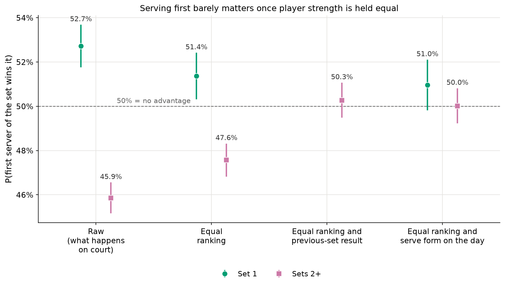
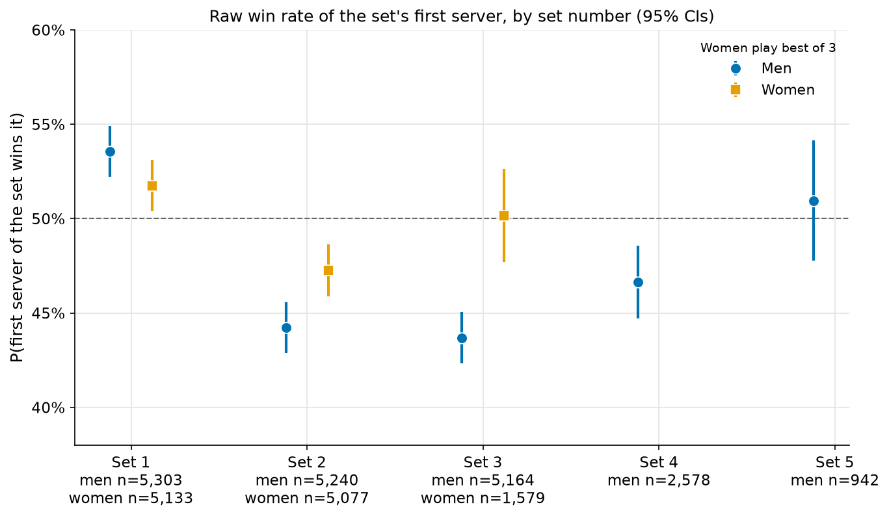
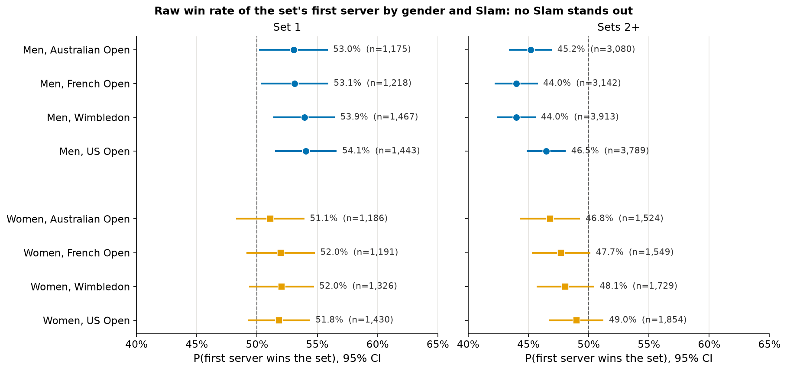
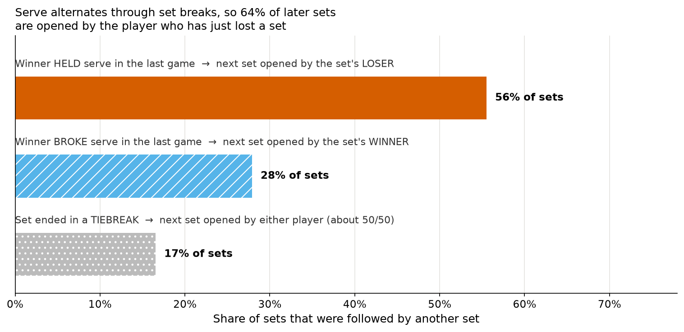
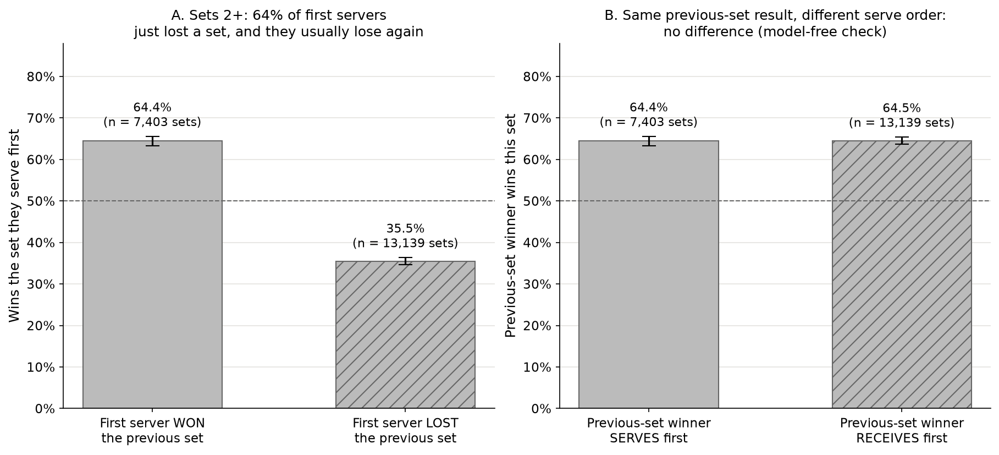
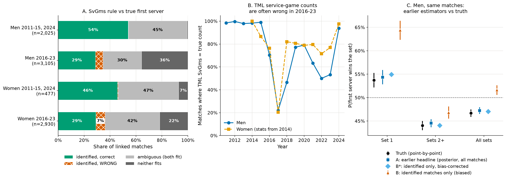
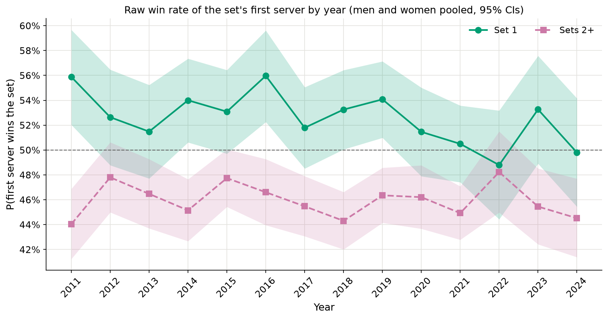

# Serving first in a set: methods and full results

This is the technical companion to the [reader summary](README.md). It holds the cleaning steps, models, validation, robustness checks and full tables.

**Question.** What is the probability that a player wins a set, given that they served the first game of that set?

This analysis uses **observed** serve order from Grand Slam point-by-point data (2011–2024, women's and men's singles). Earlier exploratory work (kept in `archive/set_first_serve_v1/`) had to *infer* the first server from match-level service-game counts. Here we have the ground truth, and we also use it to check that earlier inference method.



## Two answers

### 1. Descriptive: when a player serves first in set 1, how often do they win it?

**52.7%** [51.7, 53.6] (n = 10,436 first sets): women 51.7%, men 53.6%.

This is what happens on court. In later sets the player who serves first wins only **45.9%** [45.2, 46.6] of the time.

### 2. Strength-adjusted: does serving first itself help?

**About 51%** for set 1, which is an edge of **0 to about 2 percentage points**, with a best estimate of 1–1.4 points.
- Adjusting for pre-match ranking gives 51.4% [50.3, 52.4].
- Adjusting for ranking and serve form on the day, measured in the match's other sets, gives 51.0% [49.8, 52.1]. That interval includes 50%.
- Pre-match rank is a noisy measure of strength. Any confounding it leaves behind pushes the estimate *up*, so 51.4% is more likely too high than too low.
- Other strength measures give 51.4–51.6%: log ranking points, rank plus rank points, 1/rank, extra terms, and dropping unranked players (checked in the independent review).

For later sets the answer is **50.3%** [49.5, 51.1], which is no edge.

These are *strength-adjusted* estimates, not proven causal effects. They answer "how often would the first server win if the two players were equally strong?", and that holds only as far as ranking and form measure strength.

**Why set 1 needs a ranking control even though there is a coin toss.** The toss does not decide who serves. It decides who *chooses*: serve, receive, or which end to start from. That choice is not random with respect to strength. In these data the better-ranked player serves first in **53.0%** of matches, where a pure coin toss would give 50%. This is mostly a men's pattern: 51.4% [50.0, 52.8] for women against 54.4% [53.1, 55.8] for men; the women's figure is barely different from a coin toss. Accordingly, the women's set-1 figure hardly moves with adjustment: 51.8% raw, 51.2% at equal ranking. So part of the raw 52.7% is "the stronger player more often serves first", not "serving first helps". The data do not record who won the toss. If they did, comparing toss winners with toss losers would be the clean experiment.

**Why later sets need a different control.** There is no toss for sets 2 onwards. Serve simply keeps alternating game by game, straight through the set break, so the first server of the next set is whoever did **not** serve the last game of the previous set. Most sets end with the winner holding serve, so 64% of later sets are opened by the player who has just *lost* a set (figures 4 and 5). Those players win only 35.5% of the time. Compare players who are level on ranking *and* on the previous-set result, and the first server wins 50.3%.

**A model-free version of the same check.** Take every later set and ask how often the winner of the previous set wins it:
- when that player serves first: **64.4%** [63.3, 65.6], n = 7,403;
- when they receive first: **64.5%** [63.6, 65.4], n = 13,139.

Same previous-set result, different serve order, and no difference (figure 5B). This comparison needs no regression model.

### How the adjustment works, in plain language

Ask: "if both players were equally strong, how often would the one serving first win?" A regression answers this by learning, from all 10,000+ matches, how much a ranking gap (or having won the previous set) shifts the chance of winning a set. It then reads off the win rate at the point where that gap is zero.
- If serving first mattered, the first server would still win more than 50% at that point.
- If the raw numbers only reflect who tends to serve first, the adjusted number returns to 50%.

Technically this is a logistic regression with match-clustered standard errors (details under Method, section 4).

### What about the earlier estimates?

- **The earlier method works when its input is clean.** When the service-game counts uniquely identify the first server, they name the right player 99.6% of the time in 2011–15 and 2024.
- **The TennisMyLife Slam service-game counts are often wrong for 2016–23** (see "Known data issue" below).
- **The earlier headline estimator still lands within about 0.5 pp of the truth** for men's Slams.
- The earlier pooled and later-set numbers (0.481 / 0.465) hold up. The earlier set-1 number (0.507) is lower than the Slam truth for men (0.536), but that reflects a different population, not a bias in the method.

## Known data issue: TennisMyLife `w_SvGms` / `l_SvGms` for Grand Slams 2016–23

**The problem.** For Grand Slam matches in 2016–23, the TennisMyLife columns `w_SvGms` and `l_SvGms` often disagree with the true number of regular (non-tiebreak) service games per player. We count the true numbers from the point-by-point data.
- **How often:** 26% of matches disagree across all years. Agreement by year drops to 22% in 2017 (figure 6B). In 2011–15 and 2024, agreement is about 98% for men. Women's stats start in 2014; women's agreement is 100% in 2014 but 87% in 2015.
- **What kind of error** (`results/svgms_error_types.csv`):
  - Tiebreaks counted as service games: 957 matches.
  - Totals too low: 760 matches.
  - The total is right but one game is credited to the wrong player: 453 matches.
- **Why it matters.** The last kind cannot be detected from totals, and it flips the first-server inference.

**Cause: the `SvGms` column itself, not match pairing.** If a wrong `SvGms` came from stats belonging to another match, or from winner and loser swapped, the other stats in the same row would be wrong too. They are not:
- The TML scores agree with the point-by-point set scores in 99% of linked matches, also in 2016–23.
- TML **serve points** (`w_svpt`, `l_svpt`) match the true point-by-point serve-point counts exactly (`results/svpt_pairing_check.csv`):
  - **96.1%** of 2016–23 matches where `SvGms` is *wrong* (98.1% within ±3 points), against 98.5% where `SvGms` is right.
  - The two players' serve-point totals are swapped in only **0.05%** of matches.
- So the stats rows belong to the right match and the right players, and only the service-game column is wrong. One plausible mechanism is tiebreaks being counted as service games. The independent review reached the same conclusion.
- **One small exception:** in the clean years (2011–15 and 2024), the few matches with a wrong `SvGms` (76) also have unreliable serve points (49% exact). Those look like genuinely bad rows rather than a column-level fault.

**What is affected.**
- **Only the service-game columns** are known to be affected.
- **Scores, players and serve points are unaffected as far as we know.** The scores and serve points agree with the pbp data as above, and 98.5% of pbp matches link to a TML row with the same pair of players.
- **Rankings and match minutes are also unaffected as far as we know**, but we did not check them against an independent source.
- **Other point-level serve stats.** Apart from `svpt`, these stats (`1stWon`, `bpFaced` and so on) were not checked one by one.

**Consequence for this analysis.** The issue affects only the validation of the earlier inference method (task 3). The main estimates use the observed serve order from the point-by-point data and do not use `SvGms` at all.

## Data

| Source | Use | Citation / licence |
|---|---|---|
| `pbp-data/slam/` | Point-by-point data for Grand Slam singles, 2011–2024. The serve order is observed directly. | Jeff Sackmann / Tennis Abstract, `tennis_slam_pointbypoint`, obtained from the fork [byshiny/tennis_slam_pointbypoint](https://github.com/byshiny/tennis_slam_pointbypoint) at commit `6febb77` (the original repository was deleted). Licensed [CC BY-NC-SA 4.0](http://creativecommons.org/licenses/by-nc-sa/4.0/): attribution is required and use must be non-commercial. |
| `tml-data/YYYY.csv` and `tml-data/YYYY_wta.csv` | Pre-tournament ranks (the strength control), plus `score` and `SvGms` for the validation | [TennisMyLife](https://stats.tennismylife.org) (© TennisMyLife; no explicit licence, please credit). The WTA files follow Sackmann's `tennis_wta` format (CC BY-NC-SA 4.0). |

**Coverage:**
- 48 events with 10,508 singles matches that have points.
- AO and FO are missing after 2021, and Wimbledon 2020 was cancelled.
- The early years cover only matches on Hawk-Eye courts.

## How to run

From the repository root (see the root README for setup):

```bash
make serve_first                                  # or: .venv/bin/python analyses/serve_first/run.py  (~1 min)
make test                                         # all tests; this analysis: .venv/bin/python -m pytest tests/serve_first
```

- Cleaned points are cached in `analyses/serve_first/cache/points_clean.pkl`. The cache key is the input file names, sizes and modification times. The cache is a local artefact and is git-ignored; `make all` clears it and rebuilds from the raw data.
- The null simulation uses a fixed seed (`SEED = 20261110`), and all CSV/JSON outputs are byte-identical across runs.
- No paths are hard-coded: data locations come from `tennis.paths` (repo root found from the package; `TENNIS_DATA_ROOT` overrides the data folder).

```
analyses/serve_first/
  run.py               entry point
  sets.py              points -> games -> sets; first server, winner, quality flags, exclusion rules
  linking.py           link pbp matches to TML rows (year, Slam, gender, names)
  estimate.py          analysis table, breakdowns, strength models, selection diagnostics
  inference.py         the earlier SvGms inference method (ported from archive/set_first_serve_v1/opus/analysis.py)
  validation.py        inference vs ground truth
  plots.py             PNG figures (numbered in reader-page order; figA1 = appendix)
  results/             CSV/JSON tables (headline.json = key numbers + data-quality counts)
  figures/             fig1..fig6, figA1
shared code (src/tennis/): paths, loaders (Slam pbp, TML), Wilson / cluster-robust CIs, clustered logit, plot style
tests/serve_first/test_core.py   first-server detection, tiebreak handling, missing games, CIs, names, SvGms rule,
                                 covariate orientation (player relabelling invariance), link orientation
```

## Method

### 1. From points to sets

The pipeline:
1. Drop placeholder rows: `PointNumber` 0, `0X` or `0Y`, with `PointServer` 0. There are 10,598 of them.
2. Group the remaining points into games, then games into sets.
3. In each game, the server is the server of its first point.
4. A **tiebreak** is a game in which both players serve and the game score is tied at 6-6 or above. Games at 6-6, 7-7 and so on in advantage sets have a single server and count as ordinary games.

**First server of a set:**
- Normally it is the server of the first point of game 1.
- Every game also "votes" through the alternation rule: odd-numbered games are served by the set's first server.
- If game 1 is missing (5 sets), the vote decides.
- If the direct call and the vote disagree (10 sets), the set is excluded.

**Set winner and score:**
- The score is counted from game winners. The game winner comes from `GameWinner`, or from the last point's `PointWinner` when `GameWinner` is blank.
- A set counts as complete only if the counted score is a legal final score: 6-0…6-4, 7-5, 7-6 with a tiebreak, 13-12 with a tiebreak, or an advantage-set score such as 12-10.

**Rule check on the ground truth.** Serve alternates every game across set boundaries, and a tiebreak counts as one game. So the first server of set *k+1* is the same player as in set *k* if set *k* had an even number of games, and the other player otherwise.
- This holds for **99.96%** of 20,542 consecutive set pairs.
- Within sets, 99.96% of games match the odd/even rule.

### 2. Data quirks and how they are handled

| Quirk | Handling | Count |
|---|---|---|
| Infosys-format files (AO and FO 2018–21) number games cumulatively across the match. `SetWinner`, `GameWinner` and `GamesWon` are blank. | Games are renumbered within each set. Set scores are rebuilt from `PointWinner` for every file, so all files go through one code path. | 2,019 matches |
| `PointNumber` is stored as text in some files (because of `0X`/`0Y` rows) | Converted to numbers. Non-numeric rows are dropped as placeholders. | 640 extra rows with an invalid server or index |
| Retirements and truncated recordings | Unfinished sets are excluded. Completed sets from the same match are kept. A sensitivity check restricted to complete matches changes the estimates by less than 0.2 pp (`sensitivity_complete_matches.csv`). | 333 sets, 366 incomplete matches |
| Missing points or games | Regular games with fewer than 4 points are kept, because the server and the game winner are still identifiable. A gap in game numbers makes the counted score illegal, so that set is excluded. | 135 short games, 9 sets with gaps |
| Server changes in the middle of a regular game | The set is excluded. | 13 sets |
| Spurious `SetWinner` flags in long advantage final sets (for example at 7-6 and 8-7 in a set that ended 12-10), with no flag at the real end | `SetWinner` is used only as a cross-check. The counted score is used instead. | 11 sets |
| Final-set formats: advantage sets (AO ≤2018, FO ≤2021, Wimbledon ≤2018); a tiebreak at 12-12 (Wimbledon 2019–21); a 10-point tiebreak at 6-6 (AO 2019–21, and everywhere from 2022); USO tiebreak at 6-6 throughout | The serve rule is the same in every format: any tiebreak counts as one game. `final_set_formats.csv` checks the observed scores against these rules. | 2 sets reached 13-12; the longest set was 26-24 (Wimbledon 2018) |
| Match files with no point data | Dropped. | 5 matches |

In total 31,016 of 31,372 sets (98.9%) are usable.

### 3. Estimation

- The outcome is whether the first server won the set.
- Intervals are 95% Wilson intervals. When a group contains several sets from the same match, we use an effective sample size of *n*/deff, where deff is the design effect from the match-clustered sandwich variance. For set 1, which has one set per match, this is exactly the Wilson interval.

### 4. Strength control (technical details)

The analysis uses logistic regressions with match-clustered standard errors. All covariates are coded from the first server's point of view and flip sign if the two roles are swapped. So `expit(intercept)` is the first server's win probability when the two players are level on every control. This is the "if both players were equally strong" number above.

| Covariate | What it captures | Why chosen |
|---|---|---|
| `d_logrank` = ln(rank of opponent) − ln(rank of first server), using pre-tournament TML ranks (unranked players set to 1500) | Ex-ante strength gap | It is fixed before the match, so it cannot be affected by the serve order. Log rank is roughly linear in win probability. |
| `prev` = +1 if the first server won the previous set, −1 if they lost it | The mechanism that assigns serve in later sets | The first server of set *k+1* is a deterministic function of the earlier sets, so `prev` is the pre-treatment confounder. |
| `d_spw_loo` = difference in serve-point win rate in the *other* sets of the match | Form on the day | An equally valid strength control (51.0% for set 1). Who serves first in set 1 cannot plausibly change the serve-point rates in the *other* sets, so this measures on-the-day strength, not a consequence of serving first. Its weakness is that it comes from the same match. |

Matched ranks are available for 98.5% of matches.

### 5. Validating the earlier inference

The validation steps:
1. Link pbp matches to TML rows by year, Slam, gender and player names. The name matcher handles full names, "A. Dolgopolov", "C Moutet", accents and hyphens, and falls back to the surname. The pair constraint makes false links unlikely.
   - Men: 5,337 of 5,338 linked.
   - Women: 5,014 of 5,175 linked.
   - The pbp set scores equal the TML score in 99.0% of linked matches.
2. Apply the ported rule from `archive/set_first_serve_v1/opus/analysis.py`. Each hypothesis (the winner served first, or the loser did) implies a number of regular service games per player. Each hypothesis is checked against `w_SvGms`/`l_SvGms`, which exclude tiebreaks.
3. Compute the earlier estimators on the same matches:
   - A: the posterior from the Markov model.
   - B: identified matches only.
   - B\*: B minus the selection bias from a null simulation (4 reps).
4. Compare all of these with the truth.

## Results

### Headline (all usable sets, women and men)

| Subset | P(first server wins set) | 95% CI | n sets (matches) |
|---|---|---|---|
| **Set 1**, raw (descriptive) | **0.527** | 0.517–0.536 | 10,436 |
| Set 1, adjusted for rank | **0.514** | 0.503–0.524 | 10,250 |
| Set 1, adjusted for rank and in-match serve form | 0.510 | 0.498–0.521 | 10,250 |
| **Sets 2+**, raw (descriptive) | **0.459** | 0.452–0.466 | 20,580 (10,334) |
| Sets 2+, adjusted for rank | 0.476 | 0.468–0.483 | 20,370 |
| Sets 2+, adjusted for rank and previous-set result | **0.503** | 0.495–0.511 | 20,332 |
| All sets, raw | 0.482 | 0.476–0.487 | 31,016 (10,461) |

### By set number, gender and Slam (raw)

| Subset | Set 1 | Sets 2+ | All sets |
|---|---|---|---|
| Women | 0.517 [0.504, 0.531], n=5,133 | 0.479 [0.467, 0.491], n=6,656 | 0.496 [0.487, 0.505] |
| Men | 0.536 [0.522, 0.549], n=5,303 | 0.449 [0.441, 0.458], n=13,924 | 0.473 [0.466, 0.480] |
| Australian Open (hard) | 0.521 [0.500, 0.541] | 0.457 [0.443, 0.472] | 0.479 |
| French Open (clay) | 0.526 [0.506, 0.545] | 0.452 [0.438, 0.467] | 0.477 |
| Wimbledon (grass) | 0.530 [0.512, 0.549] | 0.452 [0.439, 0.466] | 0.478 |
| US Open (hard) | 0.529 [0.511, 0.548] | 0.473 [0.460, 0.486] | 0.492 |

- Rank-adjusted set 1 by gender: women 0.512 [0.497, 0.527], men 0.515 [0.501, 0.530].
- Adjusted sets 2+ (rank and previous set): women 0.505, men 0.501.
- By set number (men): 0.536, 0.442, 0.437, 0.466, 0.509 for sets 1 to 5.
- By set number (women): 0.517, 0.472, 0.501.
- **Heterogeneity tests** (`heterogeneity_tests.csv`): joint Wald tests from a match-clustered logit on the raw outcome.
  - Slam: p = 0.90 for set 1, p = 0.10 for sets 2+.
  - Year: p = 0.31 for set 1, p = 0.50 for sets 2+.
  - Gender, set 1: p = 0.06.
  - Gender, sets 2+: p = 0.0001. This difference is expected rather than a serve effect. Women play best of 3 and men best of 5, and the selection through the previous set differs between those formats. After adjustment both are about 50% (women 50.5%, men 50.1%).
- Per-year results: `results/estimates_by_group.csv` (tables `year` and `gender x year`), with a stability check in the appendix.




### Why later sets look worse for the first server: selection

**Who opens the next set.** Serve rotation runs straight through set breaks. So the first server of set *k+1* is whoever did **not** serve the last game of set *k* (`set_endings.csv`):

| How set *k* ended | Share of sets | Who opens set *k+1* |
|---|---|---|
| The winner held serve in the last game | 55.5% | The **loser** of set *k* |
| The winner broke serve in the last game | 27.9% | The **winner** of set *k* |
| A tiebreak | 16.6% | Either player (51% the loser) |
| **All** | 100% | The loser in **64.0%** of cases |



**Previous set and win rate.** A first server who has just lost a set wins the next one only 35.5% of the time, against 64.4% for one who has just won (`selection.csv`).
- Lost the previous set: 35.5% [34.6, 36.4], n = 13,139.
- Won the previous set: 64.4% [63.3, 65.6], n = 7,403.
- Because losers outnumber winners almost two to one among later-set first servers, the raw average comes out at 45.9%.
- Holding the previous-set result and ranking equal, it is 50.3% (figure 1).
- Figure 5B gives the model-free version: the previous-set winner wins 64.4% when serving first and 64.5% when receiving first.



### Validation of the SvGms-based inference



| Linked matches with score and stats | Identified (one hypothesis fits) | Correct when identified | Neither fits |
|---|---|---|---|
| Women 2011–15, 2024 (n=477) | 220 | 99.1% | 7.1% |
| Women 2016–23 (n=2,930) | 1,058 | 80.3% | 21.7% |
| Men 2011–15, 2024 (n=2,025) | 1,095 | **99.7%** | 0.7% |
| Men 2016–23 (n=3,105) | 1,070 | 83.5% | **35.7%** |

**Why 2016–23 is worse.** The drop is caused by the `SvGms` errors described under "Known data issue" above.

**Ambiguous matches.** The posterior from score and breaks has a Brier score of 0.150 for men and is 79% accurate, consistent with the earlier internal validation (Brier 0.119, 83%). It is reasonably well calibrated (`validation_posterior_calibration.csv`).

**Estimators against the truth on the same men's matches** (`validation_estimators.csv`):

| Men, same 4,007 matches | Truth | A: posterior | B: identified only | B\*: B corrected |
|---|---|---|---|---|
| Set 1 | 0.537 [0.522, 0.553] | 0.544 | 0.644 | 0.549 |
| Sets 2+ | 0.440 [0.431, 0.450] | 0.445 | 0.468 | 0.441 |
| All sets | 0.467 [0.459, 0.475] | 0.472 | 0.516 | 0.470 |

In the clean-SvGms years, estimator A matches the truth on all sets exactly (0.471 vs 0.471), and set 1 is within 0.8 pp. For women, where the faulty years dominate, A overstates set 1 by 3.6 pp (0.550 vs 0.514).

**Do the earlier estimates (0.507 / 0.465 / 0.481) hold up?**
- **The method:** yes. Estimator A, which was the earlier headline, is close to unbiased even on partly corrupted input. Using identified matches only (B) is biased by about +10 pp, exactly as the earlier work warned. The earlier SvGms consistency check would have missed the 2016–23 Slam errors, but Slams are only about 4% of ATP matches.
- **The numbers:**
  - Pooled: 0.481 against a Slam truth of 0.482 (men 0.473). The earlier "Grand Slam" row was 0.476.
  - Sets 2+: 0.465 against 0.459 (men 0.449).
  - Set 1: 0.507 against 0.527 (men 0.536). This gap is a difference in population (all ATP levels from 1991, best of 3, against best-of-5 Slams). It is not an inference bias: on the same men's matches, A gives 0.544 against a truth of 0.537.
- **The interpretation:** two refinements.
  1. Set 1 is *not* fully randomised. Part of the raw set-1 edge is strength.
  2. "Sets 2+ is mostly selection" is confirmed and sharpened. The deficit is *entirely* selection, and it runs through who served the last game of the previous set.

## Caveats

- **Scope:** Grand Slams 2011–24 only. There is no AO/FO data after 2021, and early years cover only show courts, which skews towards stronger players. Women play best of 3 and men best of 5, so the gender comparison is confounded with format.
- **The coin-toss choice is not observed.** We see who served first, not who won the toss. The rank imbalance shows that the choice correlates with strength, but its cause is not identified.
- **The strength proxy is limited.** Rank is a coarse measure of strength, and residual confounding most likely biases the set-1 edge *upward*. Adding in-match serve form lowers it from 1.4 to 1.0 points, and the interval then includes zero. The honest summary is an edge of 0 to about 2 points.
- **Controlling for the previous set's result** answers "is there an effect of serving first *between players in the same match situation*". It does not cover momentum effects that also differ by serve order.
- **Unranked players** are imputed at rank 1500 (66 sets). Linking fails for 3% of women's matches, mainly name variants the matcher cannot resolve. Those matches are kept in the raw estimates and dropped from the regressions.
- **The validation** covers Slams only. TML `SvGms` quality at other tournaments cannot be checked with this data.

## Conclusion

Serving first in a set barely matters.
- In the first set, the first server wins 52.7% of the time. About half of that small edge comes from stronger players, mostly men, more often choosing to serve first. Between equally strong players it is about 51%, an edge of 0 to 2 percentage points.
- In later sets the first server wins only about 46% of the time. That is not because serving first hurts. Sets usually end with the winner holding serve, so the next set is usually opened by the player who has just lost a set. Between players of equal ranking and the same previous-set result, it is a coin flip: 50%. Without any model, the previous-set winner wins the next set 64% of the time whether they serve first or not.
- The earlier estimates from inferred serve order hold up well. The pbp ground truth exposes widespread errors in the TML service-game counts for 2016–23 Slams, but the earlier main estimator was robust to them.

## Appendix: stability over time

This is a check only. The per-year estimates scatter around the pooled values with no trend over 2011–24, and a year effect is not significant (p = 0.31 for set 1, p = 0.50 for sets 2+). Each year has only about 500–1,000 first sets, so the per-year intervals are wide.



## Review record

This analysis was independently cross-reviewed by a second agent, and the fixes were verified.
