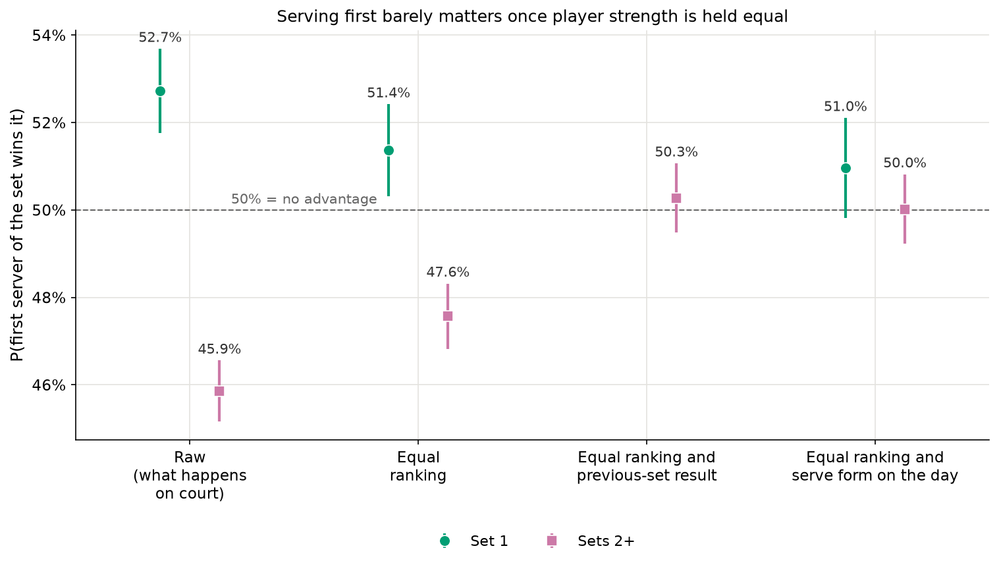
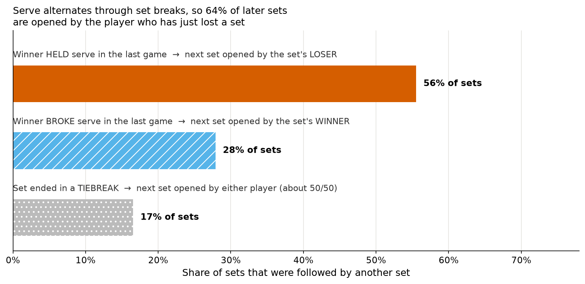
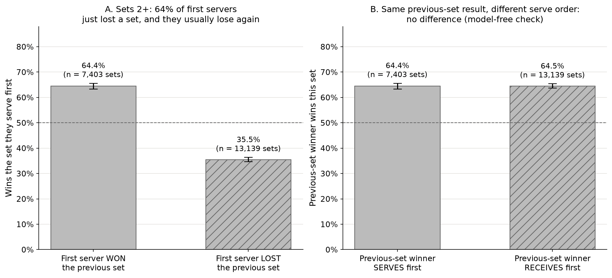

# Does serving first in a set help you win it?

**Short answer:** Yes, slightly. The player who serves first wins 52.7% of first sets. Against an equally ranked opponent it is about 51%, an edge of roughly 1 percentage point (somewhere between 0 and 2). In later sets there is no edge: the first server wins only 45.9%, but only because the player who has just lost a set usually serves first in the next one.


## Serving first looks useful in set 1



In set 1 the first server wins 52.7% of 10,436 sets (women 51.7%, men 53.6%). Compare players of equal ranking and it drops to 51.4%. Add how well each player served in the rest of that match and it is 51.0%, and that range includes 50%. Rank is a rough measure of strength, so even 51.4% is more likely too high than too low.

Why strength matters here: the coin toss decides who gets to *choose* whether to serve, receive or pick an end. In these data the better-ranked player serves first in 53.0% of matches, not 50%. This is mostly a men's pattern (men 54.4%, women 51.4%). The data do not record who won the toss, so we cannot test it directly.

## Why later sets look worse for the first server



Serve alternates game by game, straight through the break between sets. So the player who serves first in the next set is the one who did *not* serve the last game of the previous set. Most sets end with the winner holding serve, so in 64% of later sets the first server is the player who has just lost a set.



A player who has just lost a set wins the next one only 35.5% of the time. One who has just won it wins 64.4%. Because losers open most later sets, the average for first servers is 45.9%. A simple check needs no model: the winner of the previous set wins the next set 64.4% of the time when serving first and 64.5% when receiving first. Serving first made no difference.

## What this does and doesn't show

- **Estimates are strength-adjusted, not proven causal.** They answer "how often would the first server win if both players were equally strong?", and that is only as good as ranking and in-match serve form are at measuring strength.
- **The honest range for set 1 is 0 to about 2 points.** Our best estimate is 1 to 1.4 points.
- **Grand Slams only, 2011–24.** The Australian and French Opens have no data after 2021, and early years cover only the main show courts, which favours stronger players.
- **Men play best of five sets and women best of three.** That affects later sets, so men and women are not directly comparable there.
- **The coin-toss result is unknown.** We see who served first, not who won the toss, so why better players serve first more often is not established.

## A side finding: a data error

The earlier work on this question had to guess who served first from service-game counts in the TennisMyLife data. Here we have the actual serve order, which lets us check that guess. The guess is right 99.6% of the time when the counts point to one answer in clean years, but those counts are wrong in about 26% of Grand Slam matches from 2016 to 2023. The error is in the service-game column only. Scores and serve points match the point-by-point data. Details are in [METHODS.md](METHODS.md).

## Data

- **Grand Slam point-by-point, 2011–24:** Jeff Sackmann / Tennis Abstract, `tennis_slam_pointbypoint`, via the fork [byshiny/tennis_slam_pointbypoint](https://github.com/byshiny/tennis_slam_pointbypoint) at commit `6febb77`. Licence: [CC BY-NC-SA 4.0](http://creativecommons.org/licenses/by-nc-sa/4.0/).
- **Rankings and match scores:** [TennisMyLife](https://stats.tennismylife.org) (no stated licence; credit given). The WTA files follow Sackmann's `tennis_wta` format (CC BY-NC-SA 4.0).

## More detail

- [METHODS.md](METHODS.md) has the cleaning steps, models, validation, robustness checks and full tables.
- This analysis was independently cross-reviewed by a second agent, and the fixes were verified.

## Reproduce

```bash
make serve_first
```
