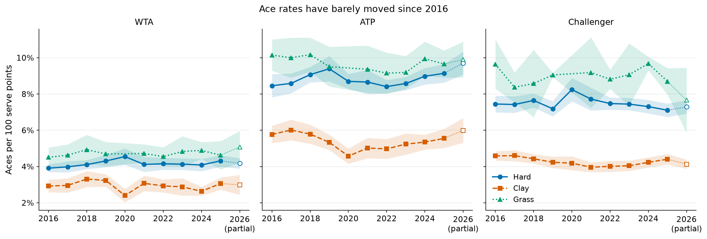
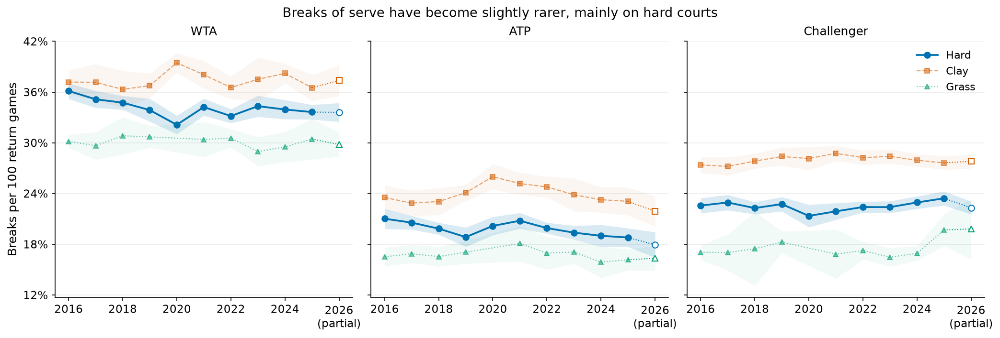
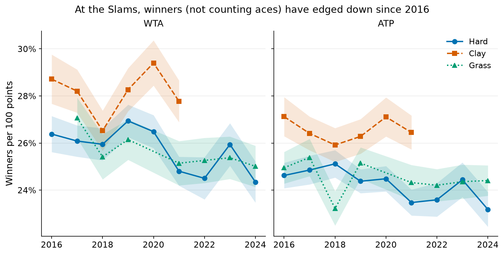
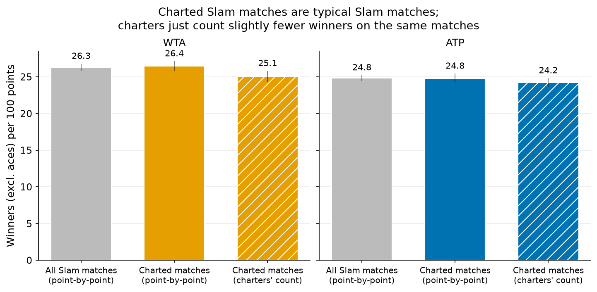
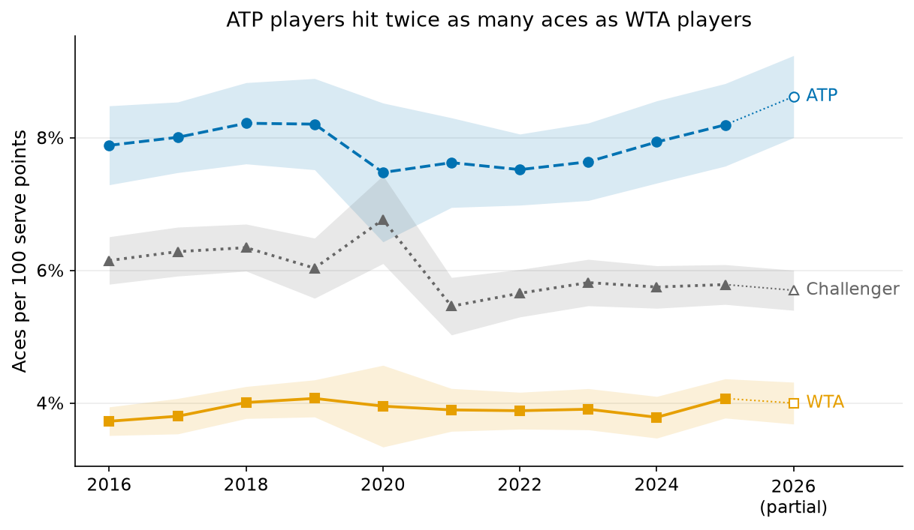
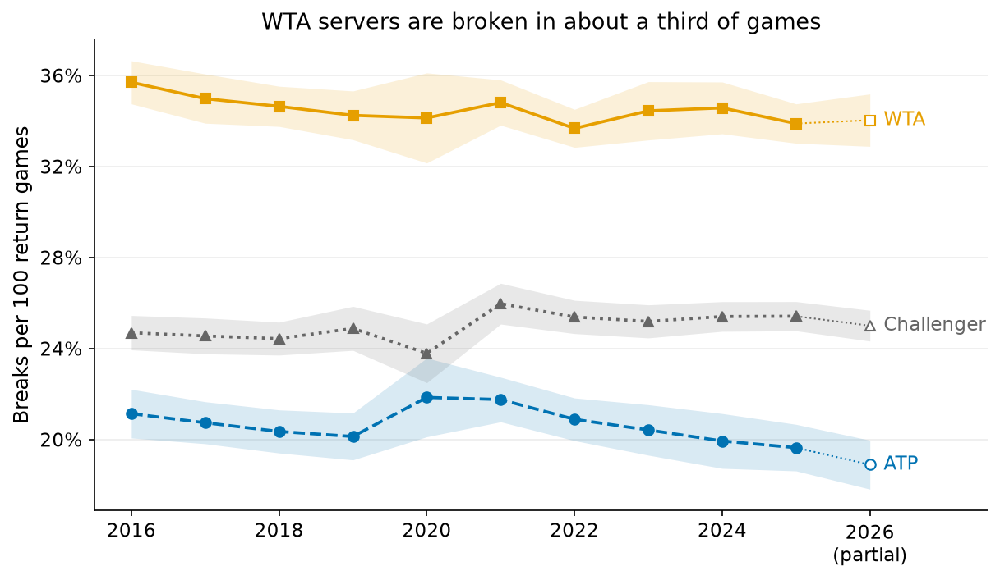
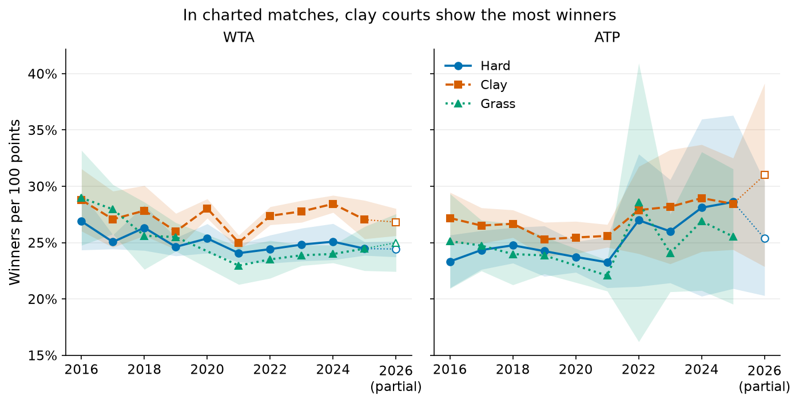
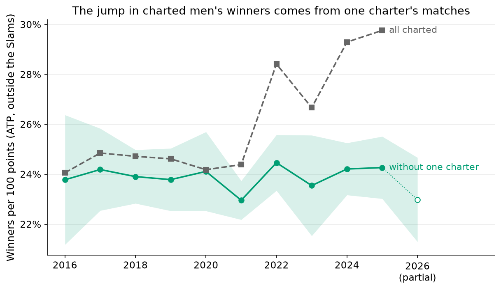
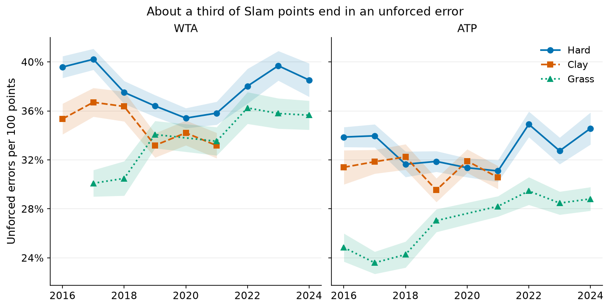

# Has the game changed from 2016 to 2026? Aces, breaks and winners

**Question.** Between 2016 and 2026, have aces, breaks of serve and winners changed on the WTA, ATP and Challenger tours, and does it differ by surface?

**Answer in plain words.**
- **Aces: no real change.** WTA players hit about 4 aces per 100 serve points, ATP players about 8 and Challenger players about 6. The tour-wide trends are all about ±0.3 per 100 serve points per decade or smaller.
- **Breaks of serve: slightly rarer, mainly on hard courts.**
  - On WTA and ATP hard courts, breaks fell by about 2 points per decade. This survives every check, including comparing each tournament only with itself over time.
  - Over all surfaces the WTA fell from 35.7% to 33.9% of return games and the ATP from 21.1% to 19.6% (2016 → 2025). The ATP all-surface decline is no longer significant once the changing tournament calendar is accounted for.
  - The Challenger tour did not change.
- **Winners (excluding aces): edging down at the Slams.**
  - About a quarter of Slam points end in a winner: 26% for women and 25% for men.
  - The rate fell by 1–2 points per decade between 2016 and 2024, including on the two Slams that use the same data feed every year.
- **One apparent change is not real.** The Match Charting Project seems to show men's winners rising sharply after 2021. That comes from **one prolific volunteer charter**: without that person's matches, the rate is flat.

**How large are the changes?** All of them are small next to the gaps between surfaces and between tours. For example, a grass-court match has about twice the aces of a clay-court match.



*Aces per 100 serve points, completed tour-level matches (TennisMyLife). Shaded bands are 95% CIs clustered by tournament; the open marker is 2026, a partial season.*



*Breaks per 100 return games, completed tour-level matches. Hard courts are highlighted; clay and grass are shown lighter for context.*

## Data

| Source | Used for | Coverage | Citation / licence |
|---|---|---|---|
| `tml-data/YYYY.csv`, `YYYY_wta.csv`, `YYYY_challenger.csv` | Aces, breaks, break-point conversion | 2016–2026: 25,135 WTA, 26,948 ATP and 51,345 Challenger completed matches | [TennisMyLife](https://stats.tennismylife.org) (© TennisMyLife); the WTA part follows Sackmann's `tennis_wta` (CC BY-NC-SA 4.0) |
| `pbp-data/slam/` | Winners, unforced errors and aces per point at the four Slams | 2016–2024: 6,832 singles matches; Australian Open and Roland Garros only up to 2021 | Jeff Sackmann, `tennis_slam_pointbypoint` (via the [byshiny fork](https://github.com/byshiny/tennis_slam_pointbypoint), commit `6febb77`), CC BY-NC-SA 4.0 |
| `pbp-data/charting/` | Winners, unforced errors and aces per point in charted matches | 2016–2026: 3,236 women's and 4,620 men's matches | Jeff Sackmann, [Match Charting Project](https://github.com/JeffSackmann/tennis_MatchChartingProject) (commit `1813a13`), CC BY-NC-SA 4.0 |

**2026 is a partial season,** with data to early November. It is plotted with open markers and left out of all trend estimates. The surfaces are Hard, Clay and Grass; there is Carpet only in 60 Challenger matches, which appear in the tables but are too few to plot.

## How to run

```bash
make serve_return_trends      # or: .venv/bin/python analyses/serve_return_trends/run.py   (~1 min)
.venv/bin/python -m pytest tests/serve_return_trends
```

- Outputs go to `results/` (CSV/JSON) and `figures/`.
- The code is in `data.py` (TML match frame), `winners.py` (Slam pbp and charting), `plots.py` and `run.py`.
- Shared helpers come from `tennis.scores` (service games from the score), `tennis.stats` (`ratio_ci`, `trend_per_decade`), `tennis.load` and `tennis.plotting`.

## Method

**Rates, not counts.** Every metric is a pooled rate: the sum of the numerator over the sum of the denominator across matches.
- Aces per serve point is `(w_ace + l_ace) / (w_svpt + l_svpt)`.
- Break % is `breaks / return games`. Breaks are each server's `bpFaced − bpSaved`, summed over both players.
- **Return games** come from the score, using `tennis.scores`: every non-tiebreak game is somebody's service game, so the return games of both players together equal the number of regular games.
  - TennisMyLife's `w_SvGms`/`l_SvGms` are never used, because they are wrong in about 26% of 2016–23 Slam matches (see `analyses/serve_first`).
  - A tiebreak, including a match tiebreak `[10-7]`, is not a service game.
- Break-point conversion is `breaks / break points faced`.

**Cleaning** (`results/cleaning_tml.csv`). From 113,095 match rows, I removed:
- 4,447 team-event matches (Davis Cup and Billie Jean King Cup);
- 4,350 retirements, walkovers and unparseable scores;
- 866 matches without serve statistics;
- 4 internally inconsistent rows.

That leaves 103,428 matches.

**Winners excluding aces.** I checked in the data whether "winners" includes aces in each source.
- **Slam point-by-point:**
  - In the IBM "Slamtracker" files (US Open and Wimbledon in every year, and Australian Open and Roland Garros up to 2017), all 62,243 aces are *also* flagged as winners.
  - In the Infosys files (Australian Open and Roland Garros 2018–21), an ace is *never* flagged as a winner.
  - A winner excluding aces is therefore "winner flag and not an ace", which is correct for both feeds.
- **Match Charting:** the Overview `winners` count includes aces: `winners ≥ aces + forehand + backhand winners` holds in all 23,624 player-match rows. So winners excluding aces = `winners − aces`, and points = both players' serve points added together.

**Uncertainty.** The 95% CIs on the yearly rates are linearised ratio CIs, clustered by:
- **tournament** for the tour files (the same event across years, matched by name: 137 WTA, 117 ATP and 504 Challenger tournaments);
- **match** for the Slam point-by-point data, where clay and grass have one event per year;
- **charter** (the volunteer who charted the match) for the charting data, because coding habits differ between charters.

**Trends** (`tennis.stats.trend_per_decade`).
- The fit is a weighted least-squares regression of the per-match rate on calendar year, weighted by the denominator, over 2016–2025.
- It controls for surface (tour data) or Slam (point-by-point data), with standard errors clustered as above.
- Trends are reported as **percentage points per decade**, for example "−1.2 breaks per 100 return games per decade".
- **Sensitivity checks:**
  - **Tournament fixed effects:** each tournament is compared only with itself over time, so changes in the calendar can't create a trend. These also absorb surface, because a tournament keeps its surface.
  - **A year × surface interaction:** tests whether the hard-court trend differs from clay and grass.

**Comparing the two winner sources.**
- 1,102 charted Slam matches were linked to the same matches in the point-by-point data, by year, Slam, gender and player names using `tennis.names`.
- That separates two things:
  - **Measurement:** do both sources count the same winners on the same match?
  - **Selection:** are charted matches typical of the Slam draw?

## Results

### Aces and breaks (TennisMyLife, 2016–2025 trend, percentage points per decade, 95% CI)

| Tour | Aces per 100 serve points: level | Trend | Breaks per 100 return games: level 2016 → 2025 | Trend | Trend with tournament fixed effects | BP conversion trend |
|---|---|---|---|---|---|---|
| **WTA** | 3.7 → 4.1 | +0.10 (−0.19, +0.39) | 35.7 → 33.9 | **−1.24 (−2.35, −0.13)** | **−1.31 (−2.56, −0.07)** | −0.55 (−1.30, +0.20) |
| **ATP** | 7.9 → 8.2 | −0.16 (−0.60, +0.28) | 21.1 → 19.6 | **−0.99 (−1.70, −0.28)** | −0.69 (−1.42, +0.03) | **−1.12 (−1.76, −0.48)** |
| **Challenger** | 6.1 → 5.8 | −0.32 (−0.64, −0.00) | 24.7 → 25.4 | +0.55 (−0.22, +1.31) | −0.33 (−1.10, +0.43) | −0.06 (−0.60, +0.49) |

**Breaks by surface** (`results/trends_tml.csv`, `break_trend_surface_differences.csv`):

| Tour | Hard | Hard, tournament FE | Clay | Grass | Clay minus hard slope | Grass minus hard slope |
|---|---|---|---|---|---|---|
| WTA | **−2.1 (−3.5, −0.7)** | **−3.0 (−4.5, −1.5)** | +0.5 (−1.4, +2.4) | −0.5 (−2.5, +1.5) | +2.5, p = 0.02 | +1.6, p = 0.16 |
| ATP | **−1.8 (−2.8, −0.8)** | **−1.3 (−2.3, −0.2)** | +0.3 (−0.8, +1.4) | −0.4 (−1.8, +1.0) | +2.1, p = 0.005 | +1.4, p = 0.07 |

- The decline is **concentrated on hard courts.**
- It is clearly different from clay, but not clearly different from grass, where the intervals are wide. "No change on clay or grass" means *not detected*, not *shown to be zero*.

**Ace rates** (aces per 100 serve points, 2016–2026 pooled):

| Tour | Hard | Clay | Grass |
|---|---|---|---|
| WTA | 4.1 | 3.0 | 4.7 |
| ATP | 8.9 | 5.5 | 9.7 |
| Challenger | 7.4 | 4.2 | 8.7 |

### Winners (excluding aces) and unforced errors per point

| Source | Women: winners per 100 points | Trend per decade | Men: winners per 100 points | Trend per decade |
|---|---|---|---|---|
| Slam point-by-point, 2016–24 | 26.3 | **−1.6 (−2.7, −0.4)** | 24.8 | **−1.1 (−1.9, −0.3)** |
| Same, US Open + Wimbledon only (one data feed) | – | **−1.9 (−3.1, −0.7)** | – | **−1.1 (−2.0, −0.1)** |
| Match Charting, 2016–25 (clustered by charter) | about 25 | −0.8 (−2.4, +0.8) | about 25 | +5.1 (−3.4, +13.6); **+0.1 (−1.7, +1.8) without one charter** |



*Winners excluding aces per 100 points, Slam singles. Hard = Australian Open + US Open (Australian Open only up to 2021); Clay = Roland Garros (to 2021); Grass = Wimbledon (no 2020). Shaded bands are 95% CIs clustered by match.*

**The men's charting "trend" is one charter** (`results/charting_charter_check.csv`, figure A4):
- One volunteer charted 31% of the men's non-Slam matches charted since 2022, and charted no women's matches.
- That charter records far more winners than anyone else: 32.3 per 100 points up to 2021, 40.9 from 2022.
- Without that charter, men's non-Slam winners are flat: **23.8 → 24.0** per 100 points.
- It is therefore not a change in which tournaments get charted. SONNET's review found that tournaments charted in both periods rise too (24.7 → 28.8), and the rise disappears once that charter's matches are removed. It reflects one person's coding.

**Are charted matches representative?**

| Comparison | Women | Men |
|---|---|---|
| All Slam matches at the same events (point-by-point) | 26.3 | 24.8 |
| Charted Slam matches (point-by-point) | 26.4 | 24.8 |
| Charted Slam matches (charters' own count) | 25.1 | 24.2 |
| Charted, reweighted to the Slam round mix | 26.5 | 24.6 |

All values are winners per 100 points (`results/source_comparison.csv`, `round_reweighting.csv`).

- **Selection at the Slams is small.** Charted Slam matches skew toward later rounds and bigger names, but their winner rate equals the whole draw's. Reweighting by round changes nothing.
- **Measurement differs slightly.** On the same 1,102 matches, charters record about 4% fewer winners than the official feed: 51,501 vs 53,473 (`same_match_agreement.csv`).
- **Unforced-error definitions differ more.** Charters record about 11% more unforced errors.
- **Aces and points agree almost exactly** (correlations 0.995 and 0.992).
- **Charting trends are only as consistent as the charters.** A single charter's habits can create a trend, as above.



*Winners excluding aces per 100 points: all Slam matches at the events where charted matches exist; the charted subset in the point-by-point data; and the same charted matches as counted by the charters. Thin lines are 95% CIs.*

**Unforced errors (context).** About 36 of every 100 Slam points end in an unforced error for women and 31 for men. On grass the rate rose by about 7–9 points per decade. Unforced errors are the least comparable statistic across data feeds and charters, so treat their trends as indicative only (figure A5).

## Caveats

- **The trends are small, and tests are many.** About 50 trend estimates are reported. A few nominally significant ones, such as ATP clay aces, are expected by chance. The consistent findings are the hard-court break decline on the WTA and ATP, which survives tournament fixed effects, and the Slam winner decline.
- **Break % depends on bpFaced/bpSaved.** I don't know of problems with those columns, but I didn't check them independently. Service games come from the score, so they don't depend on the faulty SvGms.
- **2020 is unusual:** fewer events, a short grass season and no Wimbledon.
- **The tournament calendar changes.** The ATP all-surface break decline loses significance with tournament fixed effects; the hard-court decline does not.
- **Slam point-by-point data changes feed.** The Australian Open and Roland Garros moved to Infosys in 2018–21 and are missing after 2021. The Slam trend controls for the Slam, and the US Open + Wimbledon check uses one feed throughout.
- **Match Charting is a volunteer sample.** Big matches and popular players dominate; the number of matches per year varies (93 women's matches in 2016, 562 in 2025); and individual charters code differently. It is fine for levels at the Slams, but not for trends outside them.

## Conclusion

From 2016 to 2026 the game changed only at the margins.
- Ace rates are flat on both tours.
- Servers are broken slightly less often on hard courts, by about 1–3 points per decade, with WTA break rates still a third of all return games against a fifth on the ATP.
- At the Slams, slightly fewer points end in a clean winner.
- The large surface and tour differences dwarf all of these trends.

## Appendix



*Figure A1. Aces per 100 serve points by tour, all surfaces pooled.*



*Figure A2. Breaks per 100 return games by tour, all surfaces pooled.*



*Figure A3. Match Charting Project: winners excluding aces per 100 points, by surface (CIs clustered by charter).*



*Figure A4. Charted men's matches outside the Slams: all charted matches vs the same without the most prolific charter (band: 95% CI clustered by charter).*



*Figure A5. Unforced errors per 100 points, Slam singles. The Infosys feed (Australian Open and Roland Garros 2018–21) defines unforced errors slightly differently.*
