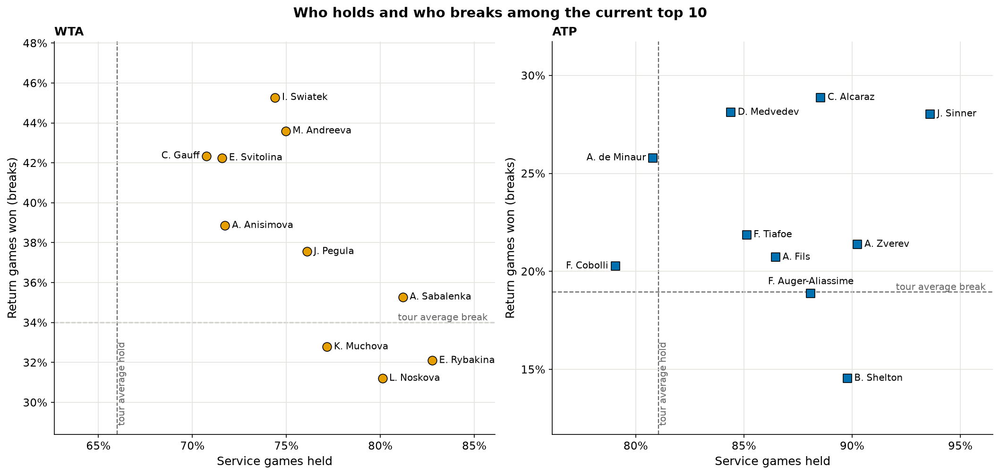
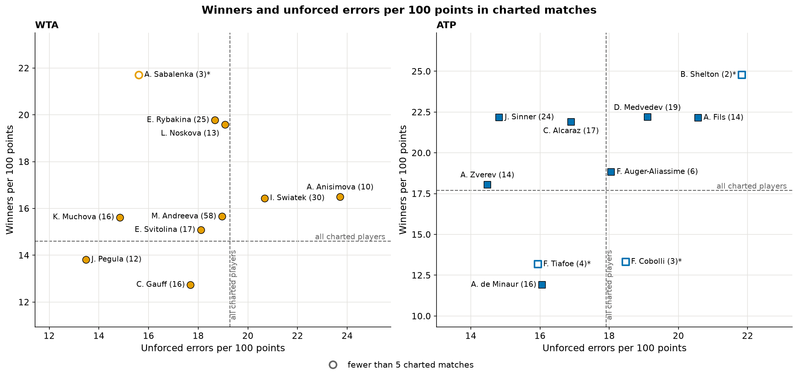
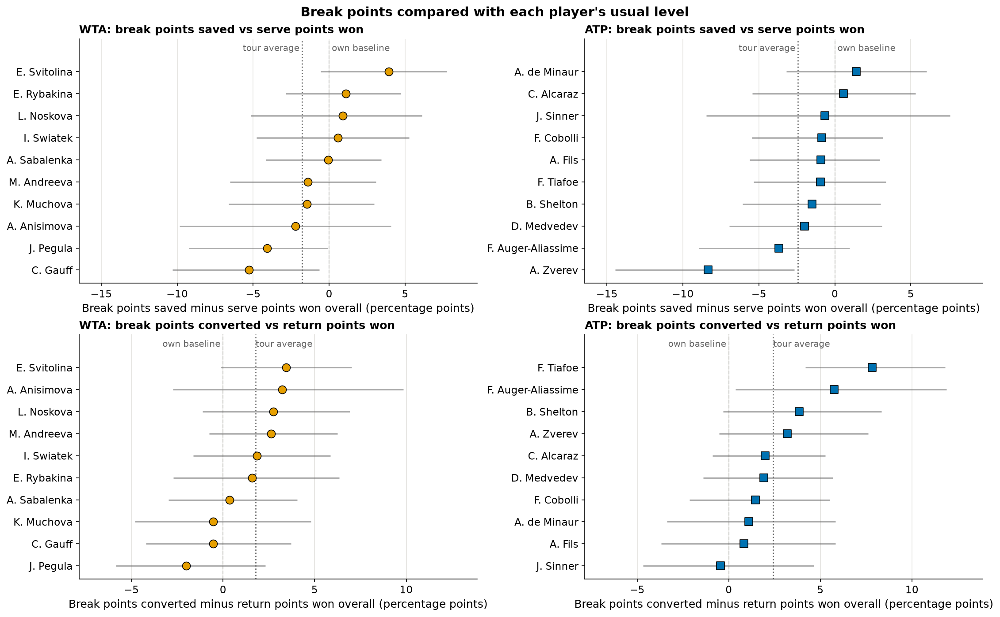
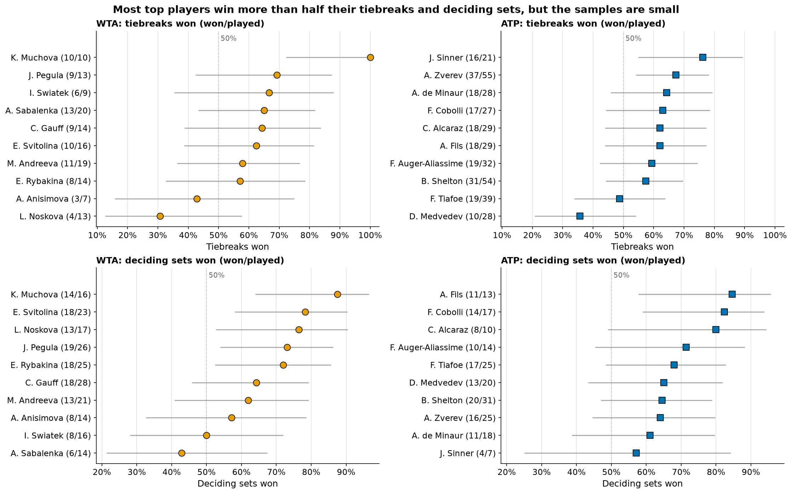
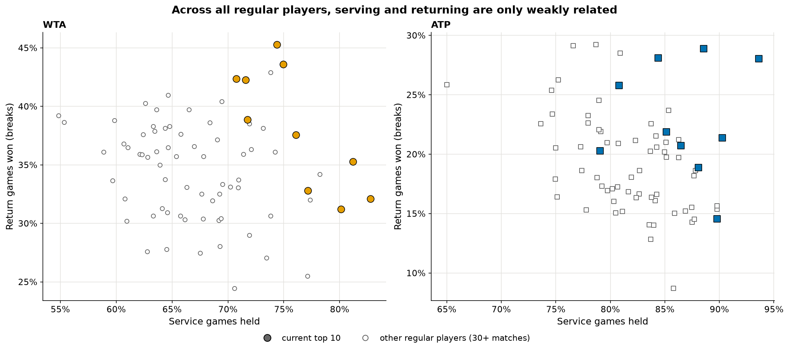
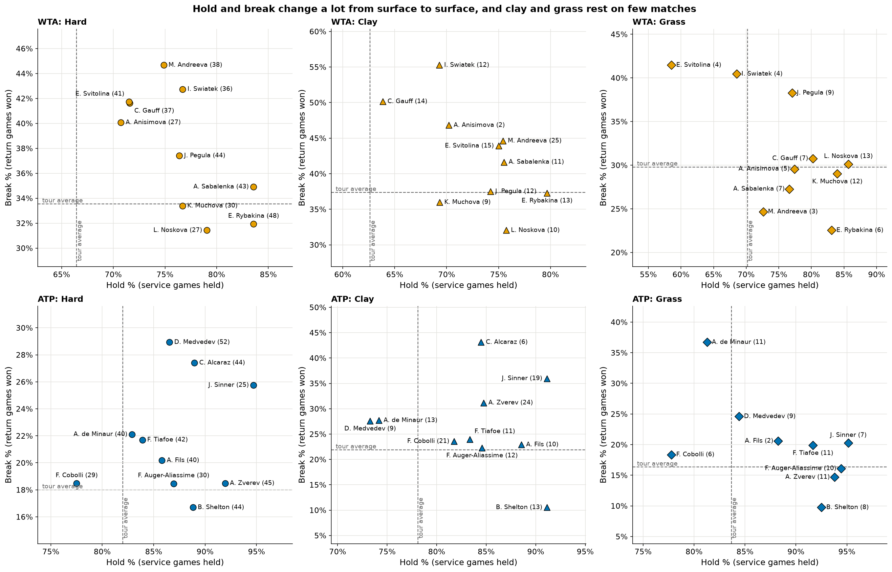
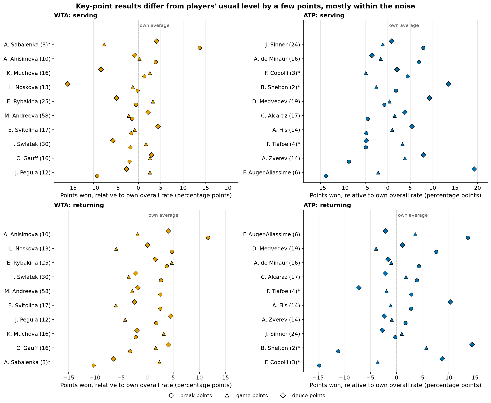

# Methods: top-10 profiles, how do the current best WTA and ATP players differ?

This is the technical companion to the [reader summary](README.md). It holds the player selection rules, definitions, tests, full tables, appendix figures and caveats.

## Question and short answer

**How do the current top-10 women and men win their matches, and do they play differently on the big points?**

* **Different routes to the top.** Some top players lean on the serve (e.g. Rybakina, Shelton: high hold, below-average break), others on the return (e.g. Swiatek, Andreeva: high break, lower hold). Do not read this as "serving and returning trade off": among all regular players the two are only weakly related (correlation of hold % with break %: -0.11 for the WTA, -0.27 for the ATP). The top 10 look like a trade-off (WTA -0.77) only because they were picked for being good at the *sum*; selecting any group on a high sum creates a negative correlation (Berkson's paradox). The 10 regular WTA players with the highest hold + break show -0.86 even though the whole tour shows -0.11. With ten players the ATP number is not meaningful: it moved from -0.38 to 0.02 when one player (Sinner) was added.
* **Winners and errors.** In charted matches, winners and unforced errors per 100 points are not clearly related among the women and positively related among the men, but with ten players (some with 2-4 charted matches) neither correlation is distinguishable from zero (WTA 0.11, CI -0.56 to 0.69; ATP 0.46, 95% CI -0.24 to 0.85).
* **Big points: top players perform about as their normal level predicts, and no player stands out reliably.** Raw break-point-saved % mostly reflects how good a server someone is, not composure, so each player is measured against their own serve and return level, and then against the tour-average gap (on break points everybody does somewhat worse than usual when serving and better when returning). Across 130 player comparisons (40 on tour data, 90 on charted key points) 10 had an uncorrected p below 0.05, about what chance alone gives (6.5 expected), and **none survives a Holm correction**. The largest deviations are Svitolina (saves 5.7 points more break points than her serving predicts, relative to the tour gap), Tiafoe (converts 5.4 points more than his returning predicts) and Zverev (saves 5.9 points fewer); none can be told apart from chance.

## Data and citation

* TennisMyLife match files (`tml-data/`, WTA and ATP tours, 2025 and 2026), (c) TennisMyLife, <https://stats.tennismylife.org>.
* Match Charting Project (`pbp-data/charting/`): Overview, KeyPointsServe, KeyPointsReturn. Jeff Sackmann / Tennis Abstract, CC BY-NC-SA 4.0, <https://github.com/JeffSackmann/tennis_MatchChartingProject>.

See the [root README](../../README.md) for licences and the exact data versions.

## How to run

```bash
make top10_profiles                 # about 2.5 minutes; writes results/ and figures/
.venv/bin/python -m pytest tests/top10_profiles
```

## Method

* **Who.** Each player's rank at their latest 2026 match in TennisMyLife, sorted by rank then by rank points (ranks recorded at different dates can tie). A player counts only if their latest match is within 12 weeks of the tour's last match in the data, otherwise their rank is stale. **One explicit override** (`FORCE_INCLUDE` in `run.py`): Jannik Sinner is included because he is still in the top 10 as of November 2026 according to the current rankings, although his last match in the data is 2026-07-12. He is placed by his last known rank (1) and uses only his matches inside the same 52-week window, so his window is partial (51 matches, none after July). The ATP list still has exactly 10 players, so **Rafael Jodar (rank 10) dropped out**. The staleness rule is unchanged for everyone else. The WTA list reflects play up to **2026-11-03**, the ATP list up to **2026-11-08**. Excluded as stale: Victoria Mboko (rank 9 on 2026-06-08). Ranks marked * are the rank at each player's latest match, recorded on different dates, so the list is approximate near ties and **the order of the top two (Sinner and Zverev, both rank 1, a July and a November ranking) is not meaningful**.
* **Matches.** The 52 weeks (364 days) up to those dates, using the tournament start date. Tour-level main-draw matches including the Grand Slams, WTA 1000/ATP Masters, 500s, 250s, the tour finals and level "A" events other than team and exhibition events (the WTA Prague Open is level "A"; the United Cup, Laver Cup and Next Gen ATP Finals are excluded by name; the Prague Open itself falls outside the current window). **Not included:** Challengers, qualifying, Davis Cup / BJK Cup. Retirements and walkovers are dropped (no clean score).
* **Service games** come from the score via `tennis.scores`, never from `SvGms` (wrong in about 26% of 2016-23 Slam matches). Serve alternates every game and tiebreaks are not service games. The first server is unknown, so each player gets half of the match's regular games. This expectation is unbiased when aggregated over many matches; on 10,114 Slam matches with the observed serve order it differs from the true count by 0.27 games per player-match, which shifts hold % by about 0.1-0.2 points, negligible next to the CIs.
* **Hold %** = 1 - breaks conceded / service games; **break %** = breaks won / return games, with breaks = opponent's break points faced minus saved. Tour references use every tour-level player in the same window.
* **Winners and unforced errors** are per 100 points (serve plus return points) from the Match Charting Overview `Total` rows in the same window, matched to TennisMyLife by name (accent- and punctuation-insensitive). The tour reference is all charted players in that window.
* **Pressure points.** Break points saved % vs the player's overall serve-points-won %, and break points converted % vs overall return-points-won %. The difference is the quantity of interest: a break point is not an average point, so everyone sits below their baseline when serving (tour average -1.8 WTA, -2.4 ATP) and above it when returning (+1.8, +2.4). Each player's gap is therefore compared with the **tour-average gap**. The same is done in the charted matches for break points, game points and deuce points.
* **Uncertainty.** Rates use the cluster-robust 95% CI of `tennis.stats.ratio_ci` (one cluster per match). Differences from a baseline use a bootstrap that resamples matches (2,000 resamples everywhere, fixed seed; the interval is widened if needed to contain the estimate). Tiebreaks and deciding sets use Wilson intervals; correlations use Fisher intervals. Typical half-widths: hold +-3.5 points, break +-4 points, break-point gaps +-4 to +-5 points.
* **Multiple comparisons.** Each player's gap minus the tour-average gap is tested with a z test on the bootstrap SD, and all comparisons are Holm-corrected together (`results/pressure_tests_holm.csv`): 40 on tour data (20 players x break points saved and converted) and 90 on charted key points (players with at least 10 charted matches x 6 situations; with fewer matches a match bootstrap is unreliable, so those players are not tested). The tour-average gap is treated as known (its own CI is about +-0.5 points).

## Results

Hold % and break % over 52 weeks, with tiebreaks and deciding sets (won/played), and break points against the player's own baseline (in brackets).

### WTA

| # | Player | Rank* | Matches | Hold % | Break % | BP saved % (serve pts won %) | BP converted % (return pts won %) | Tiebreaks won | Deciding sets won |
|---|---|---|---|---|---|---|---|---|---|
| 1 | Elena Rybakina | 1 | 67 | 82.8 | 32.1 | 65.6 (64.5) | 44.1 (42.5) | 8/14 | 18/25 |
| 2 | Aryna Sabalenka | 2 | 61 | 81.2 | 35.3 | 64.3 (64.4) | 44.3 (44.0) | 13/20 | 6/14 |
| 3 | Coco Gauff | 4 | 58 | 70.8 | 42.3 | 54.1 (59.4) | 46.5 (47.0) | 9/14 | 18/28 |
| 4 | Jessica Pegula | 4 | 65 | 76.1 | 37.6 | 58.0 (62.1) | 43.0 (45.0) | 9/13 | 19/26 |
| 5 | Mirra Andreeva | 5 | 66 | 75.0 | 43.6 | 59.6 (61.0) | 49.9 (47.3) | 11/19 | 13/21 |
| 6 | Linda Noskova | 6 | 50 | 80.1 | 31.2 | 64.1 (63.2) | 43.8 (41.1) | 4/13 | 13/17 |
| 7 | Elina Svitolina | 6 | 60 | 71.6 | 42.2 | 62.6 (58.7) | 50.1 (46.7) | 10/16 | 18/23 |
| 8 | Karolina Muchova | 7 | 51 | 77.2 | 32.8 | 61.3 (62.7) | 42.1 (42.6) | 10/10 | 14/16 |
| 9 | Iga Swiatek | 9 | 52 | 74.4 | 45.3 | 62.0 (61.4) | 50.0 (48.1) | 6/9 | 8/16 |
| 10 | Amanda Anisimova | 10 | 34 | 71.7 | 38.9 | 57.4 (59.6) | 48.8 (45.6) | 3/7 | 8/14 |

### ATP

| # | Player | Rank* | Matches | Hold % | Break % | BP saved % (serve pts won %) | BP converted % (return pts won %) | Tiebreaks won | Deciding sets won |
|---|---|---|---|---|---|---|---|---|---|
| 1 | Jannik Sinner † | 1 | 51 | 93.6 | 28.0 | 72.1 (72.8) | 40.0 (40.4) | 16/21 | 4/7 |
| 2 | Alexander Zverev | 1 | 80 | 90.3 | 21.4 | 62.9 (71.3) | 39.8 (36.6) | 37/55 | 16/25 |
| 3 | Carlos Alcaraz | 3 | 50 | 88.5 | 28.9 | 68.3 (67.7) | 43.1 (41.1) | 18/29 | 8/10 |
| 4 | Ben Shelton | 4 | 65 | 89.8 | 14.5 | 69.1 (70.6) | 36.4 (32.6) | 31/54 | 20/31 |
| 5 | Daniil Medvedev | 5 | 70 | 84.4 | 28.1 | 63.9 (65.9) | 42.7 (40.8) | 10/28 | 13/20 |
| 6 | Felix Auger-Aliassime | 6 | 52 | 88.1 | 18.9 | 65.5 (69.2) | 41.3 (35.5) | 19/32 | 10/14 |
| 7 | Flavio Cobolli | 6 | 56 | 79.1 | 20.3 | 62.2 (63.1) | 38.1 (36.6) | 17/27 | 14/17 |
| 8 | Arthur Fils | 7 | 52 | 86.5 | 20.7 | 67.2 (68.1) | 37.1 (36.3) | 18/29 | 11/13 |
| 9 | Frances Tiafoe | 8 | 64 | 85.1 | 21.9 | 65.2 (66.1) | 43.6 (35.8) | 19/39 | 17/25 |
| 10 | Alex de Minaur | 9 | 64 | 80.8 | 25.8 | 65.3 (63.9) | 40.7 (39.6) | 18/28 | 11/18 |

† Sinner is a documented override with a partial window: his matches run only from 2025-11-09 to his last match on 2026-07-12 (51 matches, none after July).

### Hold and break



Dashed lines are the tour averages for all tour-level players in the window (hold 66.0% and break 34.0% for the WTA; 81.1% and 18.9% for the ATP; hold and break average to 100% together by construction). The WTA is about 15 points lower on hold because return games are won far more often. Typical 95% CI: hold +-3.5 points, break +-4 points. For why the top 10 look like a trade-off but the tour does not, see Appendix A1.

### Winners and unforced errors



Numbers in brackets are charted matches; hollow markers flag players with fewer than 5 (Sabalenka, Shelton, Cobolli, Tiafoe; Sinner has 24). Charted matches are a selected sample (often big matches, not a random draw), so these are not a full-season profile. Typical 95% CI: winners +-2.7, unforced errors +-2.3 per 100 points. Not shown by surface: the charted samples are too small. Table: `results/winners_unforced_charted.csv`.

### Pressure points against the player's own baseline



Raw break-point-saved % mostly reflects how well someone serves: Rybakina saves 65.6% and Gauff 54.1% mainly because Rybakina wins 64.5% of her service points and Gauff 59.4%. The figure subtracts that baseline. Grey whiskers are 95% CIs (about +-4 to +-5 points). The dotted line is the tour-wide average of the same difference. Measured against that line (the right comparison), the most extreme cases are Tiafoe converting +5.4 points above the tour gap (p = 0.005, Holm-adjusted p = 0.63), Svitolina saving +5.7 (p = 0.007, adjusted 0.90) and Zverev saving -5.9 (p = 0.047, adjusted 1.0). With 130 comparisons, about six nominal p < 0.05 results are expected by chance. Tour-wide gap by surface (serve): Hard -2.0 (WTA) / -2.5 (ATP), Clay -1.3 / -2.5, Grass -1.2 / -1.5 (`results/tourwide_by_surface.csv`); per-player surface splits would have too few break points to read.



Tiebreak counts are 7 to 55 per player and deciding sets 7 to 31, so every interval is wide (Wilson 95% CI), and Muchova's 10/10 and 14/16 are small-sample results. 50% is a coin flip, but stronger players are expected to win more than half.

## Appendix

### A1. Why the top 10 look like a trade-off: selection



Hold % and break % of every player with at least 30 matches in the window (75 WTA, 71 ATP) against the current top 10. Correlation of hold with break (`results/selection_check.csv`):

| Tour | All regular players (95% CI) | Current top 10 (95% CI) | The 10 regulars with the highest hold + break |
|---|---|---|---|
| WTA | -0.11 (-0.33 to 0.12) | -0.77 (-0.94 to -0.28) | -0.86 |
| ATP | -0.27 (-0.48 to -0.04) | 0.02 (-0.62 to 0.64) | -0.25 |

### A2. Hold and break by surface



Numbers in brackets are the player's matches on that surface. By surface (Hard, Clay, Grass; no Carpet in 2025-26), tour-wide hold is lower on clay for both tours (WTA 62.6%, ATP 78.1%) and higher on grass (WTA 70.2%, ATP 83.7%). Per player, clay and grass rest on 2 to 25 matches, so single points move a lot. Table: `results/hold_break_by_surface.csv`.

### A3. Charted key points



From the Match Charting Project: break points, game points and deuce points against the player's own overall serve or return rate. Numbers in brackets are charted matches, * means fewer than 5. Charted tour-wide, game points on serve are won 1.2 (WTA) and 1.4 (ATP) points more often than the serve average and break points 2.8 and 2.1 points less often. The per-player CIs (about +-5 to +-10 points) are not drawn because they would hide the pattern; no player's deviation from the tour pattern survives the Holm correction (`results/pressure_tests_holm.csv`). Table: `results/charted_key_points.csv`.

## Caveats

* Ten players per tour, so correlations and rankings are descriptive and fragile; the hold/break pattern among the top 10 is mostly selection.
* Top-10 membership uses ranks recorded at different dates; the list is approximate near ties and excludes Mboko (stale rank). Sinner is an explicit override with a partial window (matches to July 2026 only), so his rates are not directly comparable with players who played to November; Jodar is the player who dropped out as a result.
* The window ends at the last match in the data, so players who stopped playing earlier (e.g. Anisimova's last match 2026-08-30) have fewer matches.
* Service games per player are an expectation (half of the regular games each), not an exact count. Matches with retirements or missing break-point statistics are dropped.
* Charted matches are a selected sample, with 2 to 58 matches per player; players with fewer than 10 charted matches are not tested for key-point differences.
* Tiebreak and deciding-set samples are small; a match tiebreak counts as a tiebreak and as the deciding set.
* Hold % and break % are shares of games, not points; a player's hold depends on the opposition faced.

## Review record

This analysis was independently cross-reviewed by a second agent, and the fixes were verified.
