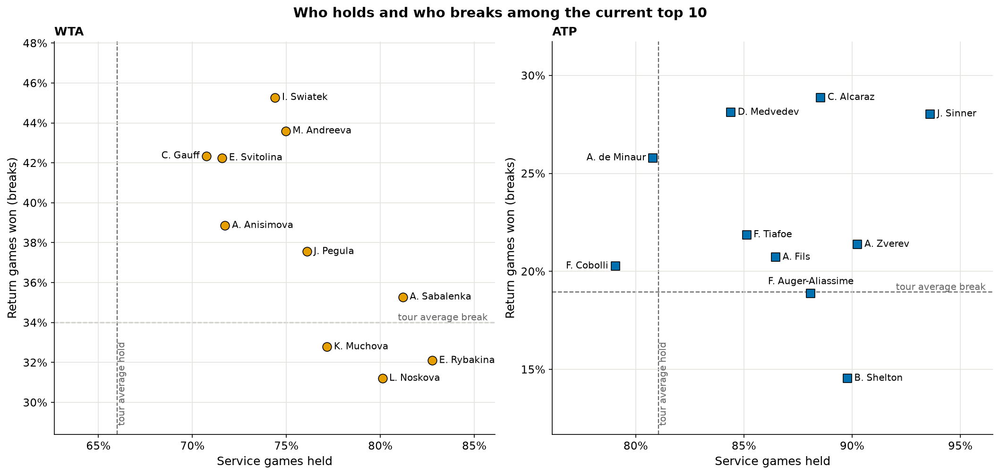
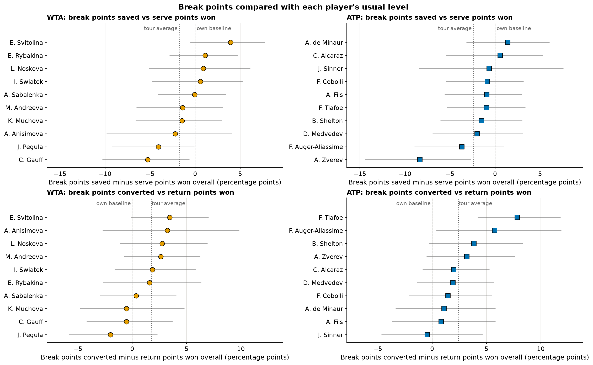
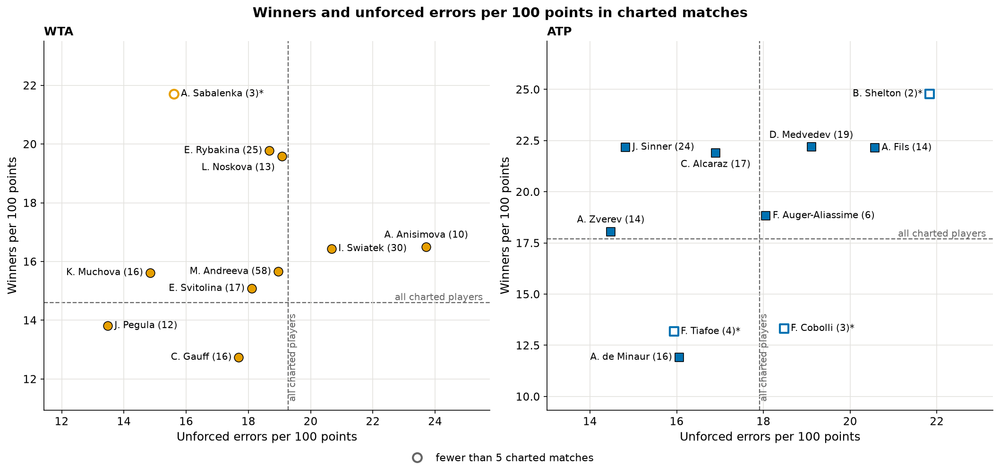

# How do the current top-10 women and men win their matches?

**Short answer:** No surprise: Rybakina leads the women on serve, holding 82.8% of her service games, while Swiatek (45.3%) and Andreeva (43.6%) are the best returners. Among the men, Sinner holds an extraordinary 93.6% of his service games. On break points, Svitolina saves far more than her serve would suggest and Zverev far fewer.


## Serve and return



**Women.** Rybakina holds serve most often (82.8%), followed by Sabalenka (81.2%) and Noskova (80.1%). On return, Swiatek breaks in 45.3% of her return games and Andreeva in 43.6%, with Gauff (42.3%) and Svitolina (42.2%) close behind.

**Men.** Sinner holds 93.6% of his service games, ahead of Zverev (90.3%) and Shelton (89.8%). Alcaraz (28.9%), Medvedev (28.1%) and Sinner (28.0%) break most often. Shelton is the clearest server: among the best at holding, but he breaks in only 14.5% of return games.

## Break points



Everyone wins a few fewer points than usual when serving at break point, so the figure compares each player with their own normal level and with that tour-wide dip.

- **Svitolina** wins 58.7% of her service points overall but saves 62.6% of the break points she faces.
- **Zverev** is the opposite. He wins 71.3% of his service points but saves only 62.9% of break points.
- **Tiafoe** converts 43.6% of his break-point chances, well above the 35.8% of return points he wins normally.
- **Gauff** saves 54.1% of break points, the lowest in the women's top 10, in line with her lower serve numbers.

## Winners and errors



In charted matches, Rybakina (19.8 per 100 points) and Noskova (19.6) hit the most winners among the women. Anisimova makes the most unforced errors (23.7), and Pegula the fewest (13.5). Among the men, Sinner (22.2 winners against 14.8 unforced errors) and Alcaraz (21.9 against 16.9) combine many winners with few errors. De Minaur hits the fewest winners (11.9).

## Notes on the data

- **The period is the last 52 weeks**, up to early November 2026, for each player's tour-level matches.
- **The list is approximate near ties.** Ranks are recorded at each player's latest match, on different dates. Sinner is included although his last match in the data is July 2026, so his numbers cover only part of the period. Mboko is left out because her rank is out of date.
- **Winners and errors come from volunteer-charted matches,** 2 to 58 per player. Sabalenka, Shelton, Cobolli and Tiafoe have fewer than 5, so their numbers are rough.

## Data

- **Matches:** [TennisMyLife](https://stats.tennismylife.org) ATP and WTA tour-level files, 2025–26. No stated licence; credit given.
- **Winners, errors and key points:** Jeff Sackmann / Tennis Abstract, [Match Charting Project](https://github.com/JeffSackmann/tennis_MatchChartingProject) at commit `1813a13`. Licence: [CC BY-NC-SA 4.0](http://creativecommons.org/licenses/by-nc-sa/4.0/).

## More detail

- [METHODS.md](METHODS.md) has the player selection rules, definitions, tests, full tables per player and appendix figures.
- This analysis was independently cross-reviewed by a second agent, and the fixes were verified.

## Reproduce

```bash
make top10_profiles
```
