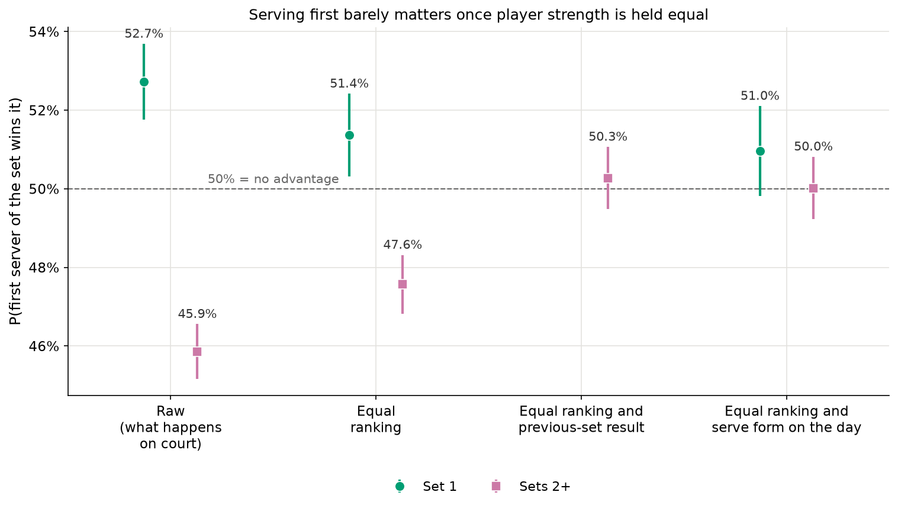
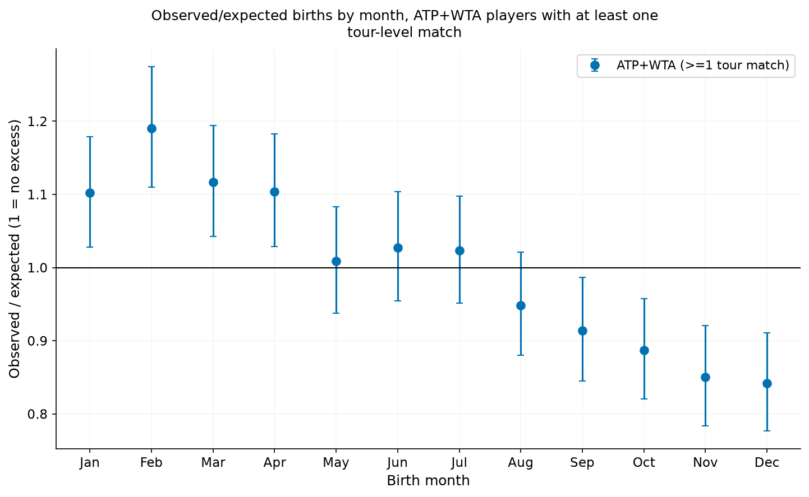
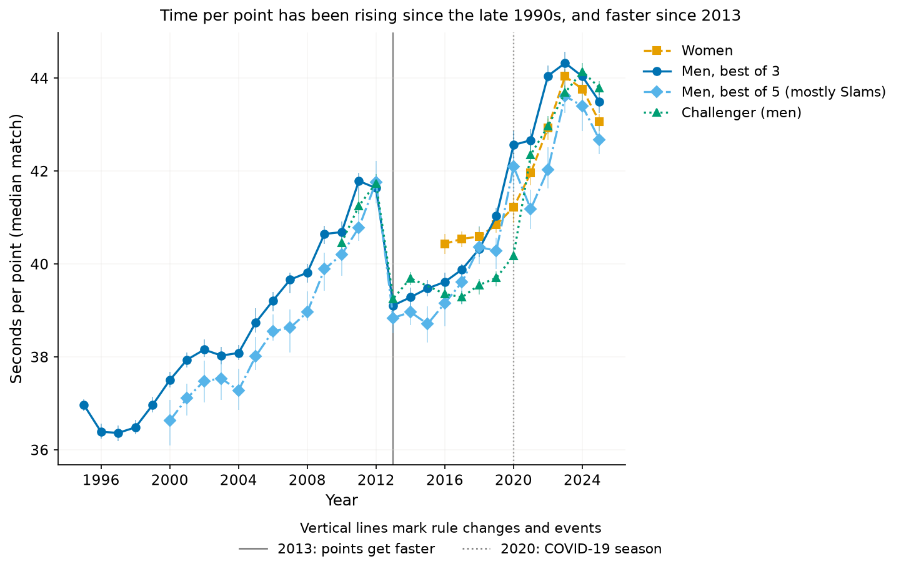
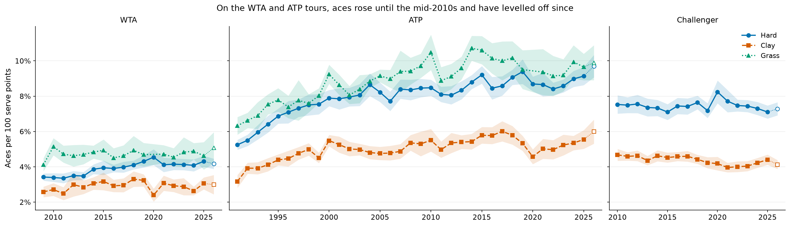
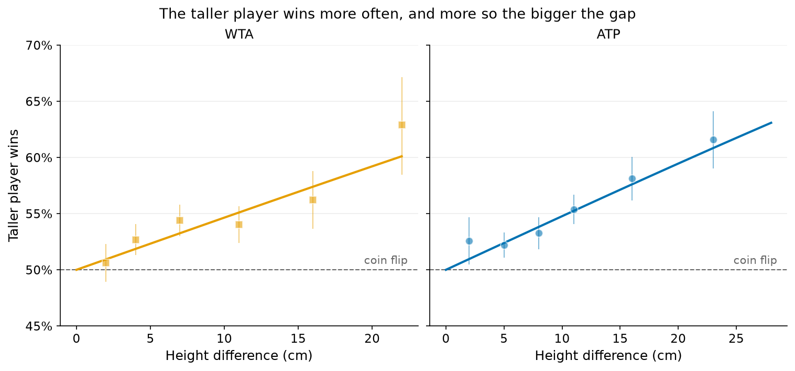
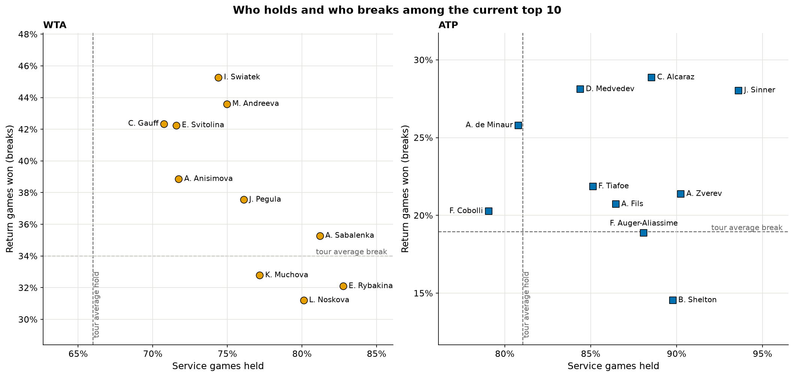

This is a curiosity project. Like many tennis fans, I have intuitions about the sport. For example, I find myself hoping my favourite player wins
the coin toss and gets to serve first. But are intuitions like this backed by data? Each page below takes one
question and answers it with public match and point-by-point data from the women's and men's tours. Click on the
question you are interested in to find out more.

::: {.qgrid}

::: {.qcard}
[{fig-alt="How often the first server wins set 1, raw and adjusted for player strength"}](analyses/serve_first/index.qmd)

[Does serving first in a set help you win it?](analyses/serve_first/index.qmd){.qtitle}

[Yes, slightly. The player who serves first wins 52.7% of first sets. Against an equally ranked opponent it is about 51%, an edge of roughly 1 percentage point (somewhere between 0 and 2).]{.qanswer}
:::

::: {.qcard}
[{fig-alt="Ratio of observed to expected births for each month, falling from January to December"}](analyses/birth_months/index.qmd)

[Are tennis players born earlier in the year than chance would predict?](analyses/birth_months/index.qmd){.qtitle}

[Yes. Among the 8,073 players who have played a tour-level match, births in January to April are 10–19% more common than an even spread over the year would give, and births in October to December are 11–16% less common.]{.qanswer}
:::

::: {.qcard}
[{fig-alt="Seconds per point in tour matches by year, rising since the late 1990s"}](analyses/match_length_trends/index.qmd)

[Are tennis matches getting longer, and why?](analyses/match_length_trends/index.qmd){.qtitle}

[Points per game, set and match have not changed for decades, but each point takes longer. A typical men's best-of-three match went from 83 minutes in 1995 to 103 in 2025.]{.qanswer}
:::

::: {.qcard}
[{fig-alt="Aces per 100 serve points by year and surface for women, men and the Challenger tour, rising and then levelling off"}](analyses/serve_return_trends/index.qmd)

[Have aces, breaks of serve and winners changed over the years?](analyses/serve_return_trends/index.qmd){.qtitle}

[Aces rose for years and have stayed level since the mid-2010s, at about 4 per 100 serve points for women and 8 for men.]{.qanswer}
:::

::: {.qcard}
[{fig-alt="Share of matches won by the taller player, rising with the height difference, for women and men"}](analyses/height_predicts_winner/index.qmd)

[Can height alone predict who wins a tennis match?](analyses/height_predicts_winner/index.qmd){.qtitle}

[A little. Knowing only the two players' heights, you would pick the winner 53.6% of the time in women's matches and 54.3% in men's, against 50% for a coin flip.]{.qanswer}
:::

::: {.qcard}
[{fig-alt="Scatter of service games held against return games won for the current top-10 women and men"}](analyses/top10_profiles/index.qmd)

[How do the current top-10 women and men win their matches?](analyses/top10_profiles/index.qmd){.qtitle}

[No surprise: Rybakina leads the women on serve, while Swiatek and Andreeva are the best returners. Among the men, Sinner holds an extraordinary 93.6% of his service games.]{.qanswer}
:::

:::

All code, results and figures are on [GitHub](https://github.com/danae1968/tennis_database), and every number can
be reproduced from the raw data with one command. The data come from
[TennisMyLife](https://stats.tennismylife.org) and from Jeff Sackmann / Tennis Abstract
([CC BY-NC-SA 4.0](https://creativecommons.org/licenses/by-nc-sa/4.0/)); see
[data sources](about/how-built.qmd#data-sources).
